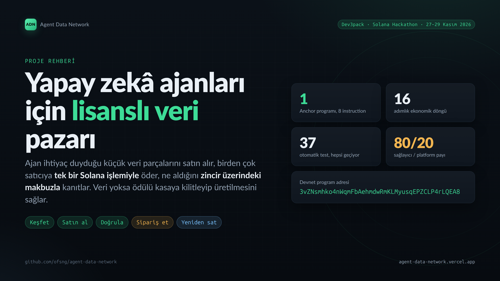
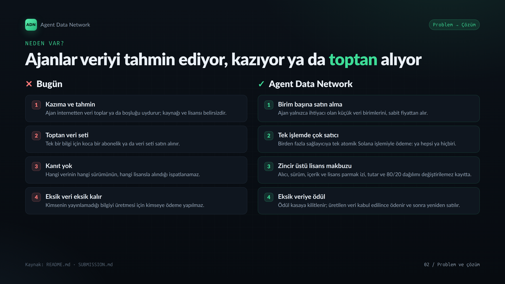

# 01 · Proje özeti

## Tek cümlede

**Agent Data Network (ADN), yapay zekâ ajanlarının ihtiyaç duydukları küçük, lisanslı veri parçalarını satın aldığı bir pazardır.** Ajan birden fazla satıcıya **tek bir Solana işlemiyle** öder, ne aldığını **zincir üzerindeki değiştirilemez bir makbuzla** kanıtlar. Aradığı veri yoksa ödülü **programın kontrolündeki bir kasaya kilitleyip** verinin üretilmesini sağlar. Üretilen veri sonra başka ajanlara **yeniden satılır**.

İngilizce slogan: **Discover → Purchase → Verify → Commission → Reuse.**
Türkçesi: **Keşfet → Satın al → Doğrula → Sipariş et → Yeniden sat.**

## Temel bilgiler

| Alan | Değer |
|---|---|
| Proje adı | Agent Data Network (kısaltma: ADN) |
| Yarışma | Dev3pack Solana Hackathon, 27–29 Kasım 2026 (hibrit, 3 gün) |
| Takım | Tek kişi: Ömer Faruk Şengül (GitHub: `ofsng`) |
| Geliştirme | Claude Code (Anthropic) ile yapay zekâ destekli; README'de açıkça belirtildi |
| Ağ | Solana Devnet (canlı) + yerel validator (geliştirme) |
| Program adresi | `3vZNsmhko4nWqmFbAehmdwRmKLMyusqEPZCLP4rLQEA8` |
| Para birimi | aUSD: 6 ondalıklı SPL test stablecoin'i (Devnet mint `DKFLsvxjFa2KJetFquiUH3cr4hp5QRuuiGVGBPjwPMDN`) |
| Komisyon | Satıcı %80, platform %20 (program içinde sabit: 2000 bps) |
| Kod deposu | https://github.com/ofsng/agent-data-network (herkese açık, MIT lisansı) |
| Canlı kopya | https://agent-data-network.vercel.app (Devnet oturumunun salt okunur kopyası) |
| Testler | 37 otomatik test, hepsi geçiyor (2 Rust + 17 Anchor + 17 uygulama/API/MCP + 1 tarayıcı) |
| Kategori | AI / Agents · Data infrastructure |

## Problem

Yapay zekâ ajanları giderek daha çok **küçük ve belirli** veri parçalarına ihtiyaç duyuyor. Bunlar farklı sahiplerin elinde duruyor: bir tedarikçinin teknik dokümanı, başka bir distribütörün stok ve teslim süresi bilgisi, ya da henüz kimsenin yayınlamadığı bir sertifika.

Bugün ajanlar bu durumda şunlardan birini yapıyor:

1. **İnternetten kazıyor** ya da eksik kısmı **tahmin ediyor (uyduruyor)**. Kaynak ve lisans belirsiz kalıyor.
2. Tek bir bilgi için **koca bir veri seti ya da abonelik** satın alıyor.
3. Sonuçta **neyin, hangi sürümünün, hangi lisansla alındığı kanıtlanamıyor.**
4. Veriyi hazırlayanlar **kullanım başına ödeme almıyor.**
5. **Eksik veri eksik kalıyor**, çünkü kimse o veriyi üretmesi için kimseye para ödemiyor.

## Çözüm

ADN bir **Anchor programı** (Solana akıllı sözleşmesi), küçük bir **servis** ve bir **web arayüzünden** oluşur. Veri birimlerini fiyatı zincirde sabitlenmiş, doğrulanabilir satın alımlara dönüştürür:

- **Atomik çoklu sağlayıcı satın alma:** Tek işlemde birden fazla `purchase_unit` talimatı. Her satıcıya %80, platforma %20 aynı anda ödenir. Bir talimat başarısız olursa hiçbir para hareket etmez.
- **Lisans makbuzları:** Her satın alma değiştirilemez bir makbuz hesabı (PDA) yazar. Makbuzda alıcı, birimin sürümü, içerik hash'i, lisans hash'i ve tutar bulunur. Ücretli baytlar yalnızca doğrulanmış makbuz ve taze bir cüzdan imzası karşılığında verilir, sonra hash ile kontrol edilir.
- **Veri güven katmanı:** Teklif vermeden önce sunucu, sakladığı baytların zincirdeki hash ile hâlâ aynı olduğunu kanıtlar. Veri ödemeden sonra bozulursa doğrulanmış yedekten (snapshot) birebir geri yüklenir, alıcı tekrar ödemeden alır.
- **Eksik veri için ödül emaneti (bounty escrow):** Birim yoksa ajan ödülü programa ait bir kasaya kilitler. Satıcı aday gönderir. İnceleme yalnızca geçti/kaldı gösterir, cevabı göstermez. Kabulde kasa 80/20 öder ve cevap ancak o zaman teslim edilir. Süresi dolan ödül tam olarak iade edilir; erken iade program tarafından reddedilir.
- **Yeniden satış:** Sipariş edilen veri ortak kataloğa girer. İkinci bir ajan satın aldığında satıcı aynı iş için tekrar kazanır.
- **Ajan korkulukları:** Ajan yalnızca tipli araçlarla çalışır; genel bir "imzala" aracı yoktur. Her harcama, imzadan önce kalıcı bir bütçe tavanına karşı rezerve edilir.
- **Kendi ajanını getir:** MCP sunucusu Claude, Cursor ya da herhangi bir MCP istemcisine aynı araçları verir. Ajan kendi cüzdanıyla, insanın onayladığı harcama hakkı içinde satın alır. Anahtar sahibinin makinesinden çıkmaz.

## Neden Solana ve neden yapay zekâ?

> "Remove AI/Solana and it breaks." (SUBMISSION.md)

- **Solana olmadan:** Atomik 80/20 bölüşüm, değiştirilemez makbuz ve programın uyguladığı emanet olmaz. Bunlar bir platformun "söz vermesine" kalır.
- **Ajan olmadan:** Kimse veriyi birim birim, saniyeler içinde, binlerce küçük alım hâlinde satın almaz. Mikro ödemeler ve otomatik karar ancak ajanla anlamlı.
- **Solana'nın uygunluğu:** Düşük ücret (işlem başına 5 000 lamport), hızlı kesinleşme, tek işlemde birden fazla talimat (atomiklik), PDA ile güvenli emanet.

## Kim için?

| Taraf | Ne kazanır |
|---|---|
| **Ajan geliştiricisi / ajan sahibi** (araştırma, tedarik iş akışları) | Her sağlayıcıyla tek tek entegrasyon yapmadan, sınırlı bütçeyle, kaynağı ve lisansı kanıtlı bilgi |
| **Veri sağlayıcı** (üretici, distribütör, uzman) | Küçük birimleri tekrar tekrar satma, kullanım başına otomatik %80 gelir, parası hazır talepleri görme |
| **Platform** | Her satıştan ve ödülden %20 |

Demodaki ilk dikey: **ekipman tedarik verisi** (güneş enerjisi invertörü, batarya, panel). Teknik özellik, stok, teslim süresi, sertifika gibi parçalı ve değerli bilgiler.

## Demo senaryosu

Ajana gerçekçi bir görev verilir: *"Voltara X100 güneş invertörü için bir satın alma brifingi hazırla: en yüksek verim, güncel teslim süresi ve geri dönüşüm sertifikası."*

1. Ajan pazarda arar, iki bağımsız sağlayıcıdan iki birim seçer: NorthLab'in teknik datasheet'i ve SouthSupply'ın stok/teslim süresi bilgisi.
2. Tek atomik işlemle ikisini satın alır (0.06 aUSD).
3. Makbuzları zincirde doğrular, içeriği alır ve hash ile kontrol eder.
4. Geri dönüşüm sertifikası hiçbir yerde yok. Ajan bunu uydurmaz, 2 aUSD ödül açar.
5. NorthLab iki aday gönderir; inceleme yanlışını eler, doğrusu geçer; ajan kabul eder.
6. Sertifika kataloğa girer; ikinci bir ajan onu 0.03'e satın alır.
7. Ayrıca başka bir talep sahibinin süresi dolan ödülü tam olarak iade edilir.
8. Ajan her bilginin yanında birimini ve makbuzunu gösteren bir brifing yazar.

Detay: [02-nasil-calisir.md](02-nasil-calisir.md)

## Dürüstlük notu (jüriye de söylenen)

- Ödemeler **aUSD** ile yapılır: Devnet'te 6 ondalıklı bir **test stablecoin'i**. Gerçek parayla karşılığı yoktur.
- Sağlayıcı kataloğu (Voltara ürünleri, NorthLab, SouthSupply) **örnek veridir**; şirketler kurgusaldır.
- Uygulamanın kendi araştırma ajanı **kurallara dayalı** bir planlayıcıdır, LLM değildir. Gerçek bir LLM (Claude) ancak MCP ile bağlandığında aynı araçları kullanır.
- Mainnet yok, gerçek para yok, müşteri ya da gelir iddiası yok.

## Kısa sunum metinleri

**30 saniyelik Türkçe anlatım:**
> Yapay zekâ ajanları küçük ve lisanslı veri parçalarına ihtiyaç duyuyor ama bugün ya kazıyor ya tahmin ediyor ya da koca veri setleri alıyor. Agent Data Network'te ajan yalnızca ihtiyaç duyduğu birimleri alıyor, birden fazla satıcıya tek bir Solana işlemiyle ödüyor ve zincir üzerindeki makbuzla ne aldığını kanıtlıyor. Veri yoksa ödülü kasaya kilitliyor, satıcı üretiyor, kabul edilince ödeniyor ve veri sonraki ajanlara yeniden satılıyor. Hepsi Devnet'te gerçek işlemlerle çalışıyor.

**30-second English pitch:**
> AI agents need small pieces of licensed data from many owners. Today they scrape, guess, or buy whole datasets. Agent Data Network lets an agent buy exactly the units it needs, pay every owner in one Solana transaction, and prove what it bought with an on-chain receipt. When data is missing, it locks a reward in a program-owned escrow; once a provider's answer is accepted, the provider is paid and the data is resold to the next agent. It all runs as real transactions on Devnet.
