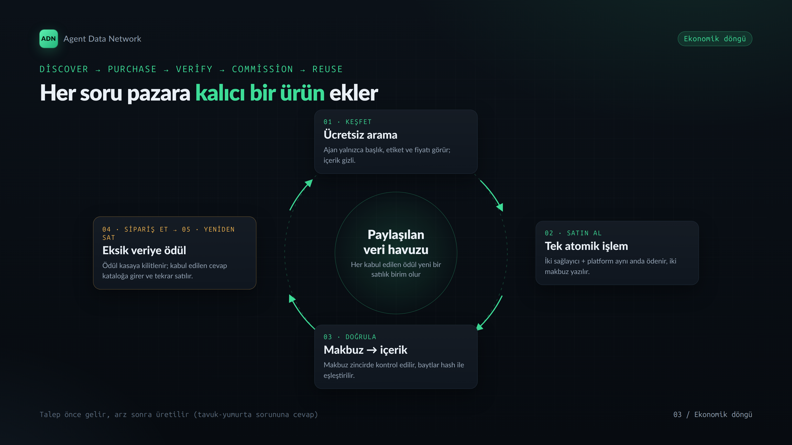
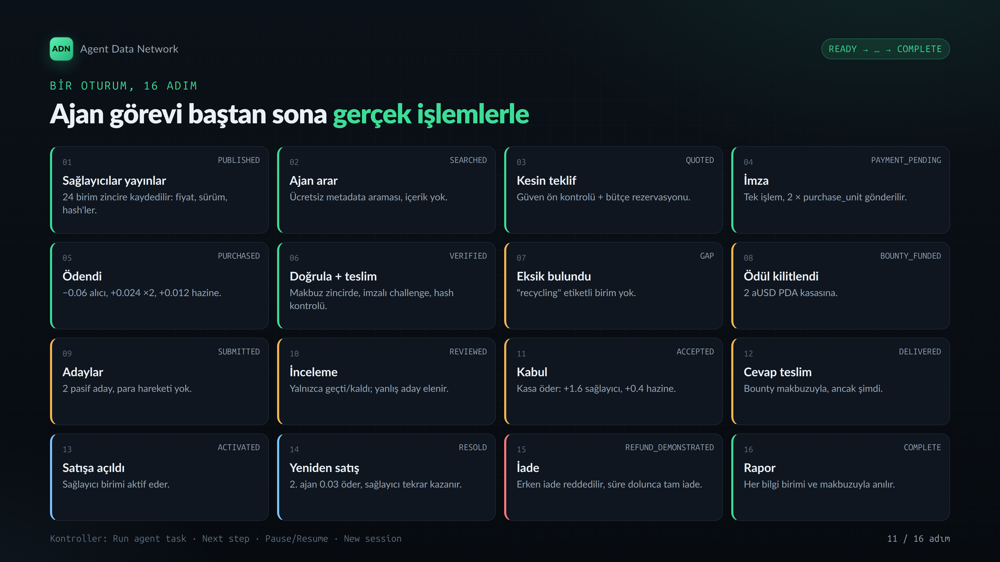
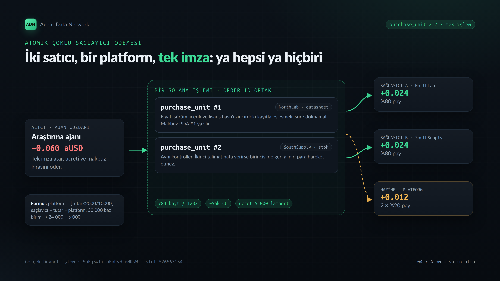
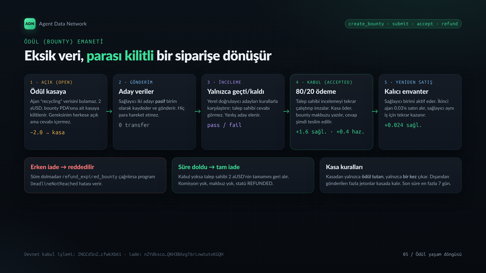
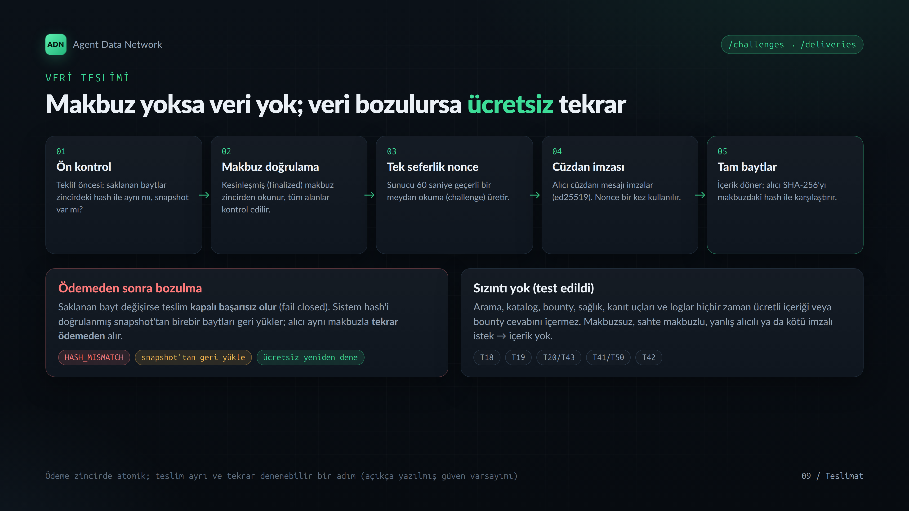
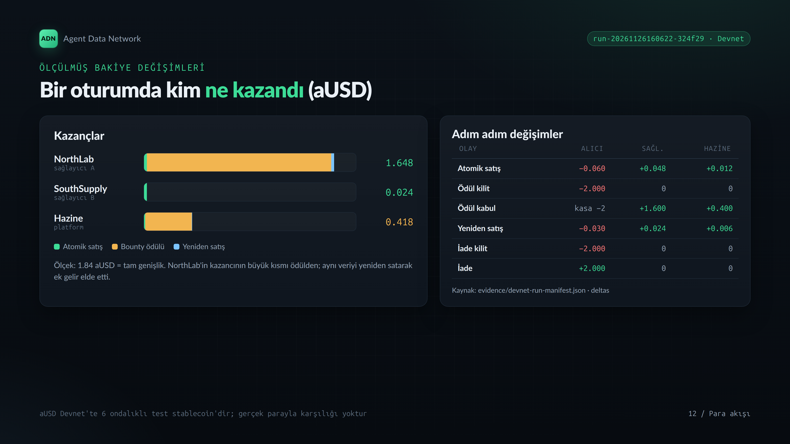

# 02 · Nasıl çalışır: 16 adımlık ekonomik döngü

## Önce basit bir benzetme

Bir **kütüphane + kırtasiye + sipariş masası** düşün:

- **Raflar (pazar yeri):** Kitapların yalnızca kapakları ve fiyatları görünür. İçini okumak için satın alman gerekir.
- **Kasa (Solana işlemi):** İki farklı yayınevinin kitabını tek fişle alırsın. Kasa ya ikisini birden satar ya hiçbirini. Para aynı anda yayınevlerine ve dükkâna bölünür.
- **Fiş (makbuz):** Fişte hangi kitabın hangi baskısını, hangi şartlarla, kaça aldığın yazar. Fiş noterde saklanır (zincir), kimse değiştiremez.
- **Sipariş masası (bounty):** Aradığın kitap yoksa parayı emanet kasasına yatırırsın. Bir yazar yazar, sen beğenirsen para yazara geçer. Kimse yazmazsa paran tam olarak geri döner.
- **Yeniden satış:** Senin için yazılan kitap rafa konur, başkaları da alır. Yazar her satışta tekrar kazanır.

## Roller

| Rol | Demodaki adı | Ne yapar |
|---|---|---|
| Sağlayıcı A | **NorthLab** (üretici teknik dokümanları) | 12 birim yayınlar, ödüle cevap üretir (kabul edilen cevapla 13) |
| Sağlayıcı B | **SouthSupply** (distribütör stok, fiyat, lojistik) | 12 birim yayınlar |
| Araştırma ajanı | Research agent | Görevi yürütür; bütçesi 2.1 aUSD, en fazla 1 ödül |
| İkinci ajan | Second agent | Sipariş edilen veriyi yeniden satın alır; bütçesi 0.1 aUSD |
| İade talep sahibi | Refund requester | Süresi dolan ödülün iadesini gösterir; bütçesi 2 aUSD |
| Hazine | ADN treasury | Platformun %20 payını toplar |
| Deployer / operatör | `Cu7ctAUxW25GsGGPVvNupujU81A9jvEZUGjo2sUdgVZ7` | Programı yükledi, aUSD basabilir, ayarları kurdu |

Not: "Voltara" bir ürün markasıdır (X100 invertörü, B20 batarya, P450 panel…). Voltara bir satıcı değildir; Voltara ürünleri hakkındaki verileri NorthLab ve SouthSupply satar.

## 16 adım

Uygulama bir durum makinesi olarak çalışır: `READY → PUBLISHED → SEARCHED → QUOTED → PAYMENT_PENDING → PURCHASED → VERIFIED → GAP → BOUNTY_FUNDED → SUBMITTED → REVIEWED → ACCEPTED → DELIVERED → ACTIVATED → RESOLD → REFUND_DEMONSTRATED → COMPLETE`.

| # | Adım | Ne olur | Zincirde |
|---|---|---|---|
| 0 | Hazırlık (New session) | Oturum için 3 yeni cüzdan açılır (ajan, ikinci ajan, iade talep sahibi), her biri tam bütçesi kadar fonlanır. Önceki oturumların sipariş edilmiş listelemeleri geri çekilir. | Fonlama transferleri, `set_asset_active=false` |
| 1 | **Yayınlama** | NorthLab ve SouthSupply 24 birimi kaydeder. Her kayıt fiyat, sürüm, içerik hash'i ve lisans hash'ini sabitler. Güven katmanı kaynak, haklar ve şemayı kaydeder. Zaten kayıtlıysa yeniden kullanılır. | `register_data_asset` |
| 2 | **Arama** | Ajan ücretsiz metadata araması yapar: başlık, etiket, fiyat, sağlayıcı. İçerik dönmez. | — |
| 3 | **Teklif** | Seçilen 2 birim için kesin teklif. Ön kontrol: zincirdeki şartlar aktif ve kesinleşmiş mi, saklanan baytlar hash ile aynı mı, doğrulanmış yedek var mı. Bütçeden rezervasyon yapılır. | Okuma |
| 4 | **İmza** | Ajan tek işlemi imzalar: 2 × `purchase_unit`, aynı order ID. | İşlem gönderilir |
| 5 | **Ödeme** | Ajan −0.060, NorthLab +0.024, SouthSupply +0.024, hazine +0.012 aUSD. İki makbuz PDA'sı yazılır. | `purchase_unit` ×2 |
| 6 | **Doğrulama + teslim** | Makbuzlar zincirde kontrol edilir (sahip program, PDA, alıcı, mint, sürüm, hash'ler, tutar). Ajan tek kullanımlık mesajı imzalar, tam baytları alır, hash'i karşılaştırır. | Okuma |
| 7 | **Eksik** | Hiçbir birimde `recycling` etiketi yok. Ajan bilgiyi uydurmaz. | — |
| 8 | **Ödül** | Ajan 2 aUSD'yi bounty PDA'sının kasasına kilitler. Herkese açık gereksinim (v2) cevabı içermez. | `create_bounty` |
| 9 | **Adaylar** | NorthLab iki aday birimi **pasif** olarak kaydeder ve gönderir. Para hareket etmez. | `register_data_asset` (pasif), `submit_bounty_solution` ×2 |
| 10 | **İnceleme** | Yerel doğrulayıcı adayları kontrol eder, yalnızca geçti/kaldı döner. Yanlış aday (`WEEE-TR-DRAFT`) `valueMatch` kontrolünden kalır. | — |
| 11 | **Kabul** | Talep sahibi incelemeyi imzadan hemen önce tekrar çalıştırır, sonra imzalar. Kasa −2 → NorthLab +1.6, hazine +0.4. Bounty makbuzu yazılır. | `accept_bounty_solution` |
| 12 | **Teslim** | Cevap (`WEEE-TR-2026-04817`) ancak şimdi, bounty makbuzuyla teslim edilir. | Okuma |
| 13 | **Satışa açma** | NorthLab birimi aktif eder; artık aramada çıkar. | `set_asset_active=true` |
| 14 | **Yeniden satış** | İkinci ajan birimi 0.03'e alır: NorthLab **tekrar** +0.024, hazine +0.006. | `purchase_unit` |
| 15 | **İade** | Ayrı bir talep sahibi 20 saniyelik bir ödül açar. Erken iade `DeadlineNotReached` ile reddedilir. Süre dolunca 2 aUSD'nin tamamı komisyonsuz geri döner. | `create_bounty`, `refund_expired_bounty` |
| 16 | **Rapor** | Ajan, her bilgiyi birimi ve makbuzuyla anan bir brifing yazar. Kazançlar ölçülmüş bakiye değişimlerinden hesaplanır. | — |

## Atomik satın alma ayrıntısı

- Solana'da bir işlem birden fazla talimat içerebilir ve **ya hepsi başarılı olur ya hiçbiri**. ADN bunu kullanır: iki `purchase_unit` talimatı tek işlemde.
- Her talimat kendi içinde: süre dolmadı mı, varlık aktif mi, imzalanan fiyat/hash'ler zincirdekiyle aynı mı, alıcı/satıcı/hazine aynı kişi mi (olmamalı), bakiye yetiyor mu, hepsini kontrol eder.
- Sonra `TransferChecked` ile %80'i satıcıya, %20'yi hazineye gönderir ve makbuzu yazar.
- Ölçülen değerler: işlem **784 bayt** (sınır 1232), **~54–64 bin CU**, ücret **5 000 lamport**. Makbuz hesabı **254 bayt**.
- Test T13: ikinci talimat geçersizse tüm işlem geri alınır, yalnızca ağ ücreti ödenir.

## Ödül (bounty) ayrıntısı

- Ödül, sahibi **bounty PDA'sı** olan bir token hesabında (kasa) durur. Kasadan para ancak programın, bounty tohumlarıyla imzalamasıyla çıkar; ne platform ne satıcı ne de başka biri doğrudan çekebilir.
- Son süre en az şimdi + 1 saniye, en fazla **7 gün** sonrası olabilir.
- Gönderim yalnızca **pasif** bir varlığa işaret eder. Böylece aday cevap, ödeme olmadan pazarda satılamaz.
- Kabulde talep sahibi; gereksinim hash'i, içerik hash'i ve lisans hash'inin beklediği değerler olduğunu imzalar. Uyuşmazsa `HashMismatch`.
- Kasadan **yalnızca ödül tutarı** çıkar, **bir kez**. Dışarıdan gönderilen fazla jetonlar ("toz") kasada kalır, süpürülmez.
- Kabul edilmiş ödül iade edilemez; iade edilmiş ödül kabul edilemez (T30).

## İnceleme neden "yalnızca geçti/kaldı"?

Talep sahibi cevabı ödemeden önce görürse, ödemeden alıp kabul etmeyebilir ("bedavaya alma"). Bu yüzden inceleme raporu yalnızca kontrollerin sonuçlarını gösterir: şema, alanlar, bütünlük, lisans, bağlama (binding), köken, değer eşleşmesi. Cevabın kendisi rapora girmez (T44/T45).

**Dürüst sınır:** Demoda inceleme, doğru cevabı önceden bilen, sistemin işlettiği zincir dışı bir doğrulayıcı. Gerçek hayatta doğru cevap önceden bilinmez. Bu bir **güven varsayımı** olarak README'de yazıyor. Çözüm önerileri: itiraz süresi, satıcı teminatı, kaynağın imzası. Bkz. [05-guvenlik-ve-guven.md](05-guvenlik-ve-guven.md).

## Teslimat

1. Alıcı `/api/v1/challenges` ile makbuzu için tek kullanımlık bir mesaj ister (60 saniye geçerli).
2. Cüzdanıyla imzalar (ed25519, tweetnacl).
3. `/api/v1/deliveries` makbuzu zincirde doğrular, imzayı ve nonce'u kontrol eder, baytları verir.
4. Alıcı SHA-256'yı makbuzdaki içerik hash'iyle karşılaştırır.

Saklanan veri bozulmuşsa teslim **başarısız olur ve veri verilmez** (fail closed). Sistem hash'i doğrulanmış yedekten birebir baytları geri yükler; alıcı aynı makbuzla, tekrar ödemeden alır. Yedek de yoksa teslim "çözülemedi" olarak raporlanır (T20/T43).

## Para nereye gidiyor? (Devnet'te ölçülen)

| Kim | Satış | Ödül | Yeniden satış | Toplam |
|---|---|---|---|---|
| NorthLab | 0.024 | 1.600 | 0.024 | **1.648 aUSD** |
| SouthSupply | 0.024 | 0 | 0 | **0.024 aUSD** |
| Hazine | 0.012 | 0.400 | 0.006 | **0.418 aUSD** (iadeden 0) |

Ajanın harcaması: 0.06 (satış) + 2.0 (ödül) = 2.06 aUSD; 2.1 tavanından 0.04 kaldı. SOL: 0.05 SOL tavanından ~0.0067 SOL kullanıldı (ücretler + makbuz kiraları).

Kaynak: `evidence/devnet-run-manifest.json` (oturum `run-20261126160622-324f29`).

## Uygulamadaki kontroller

| Düğme | Ne yapar |
|---|---|
| **Run agent task** | Görevi baştan sona otomatik çalıştırır (Devnet'te ~3–4 dakika, çoğu kesinleşme beklemesi) |
| **Next step** | Bir sonraki adımı çalıştırır |
| **Pause / Resume** | O anki adım bitince durur / devam eder |
| **New session** | Yeni cüzdanlarla izole yeni bir oturum açar; eski oturumlar, makbuzlar ve anahtarlar korunur |
| **? Tour** | Rehberli turu tekrar açar |

Başsız (headless) aynı çalışma: `npm run demo`.
