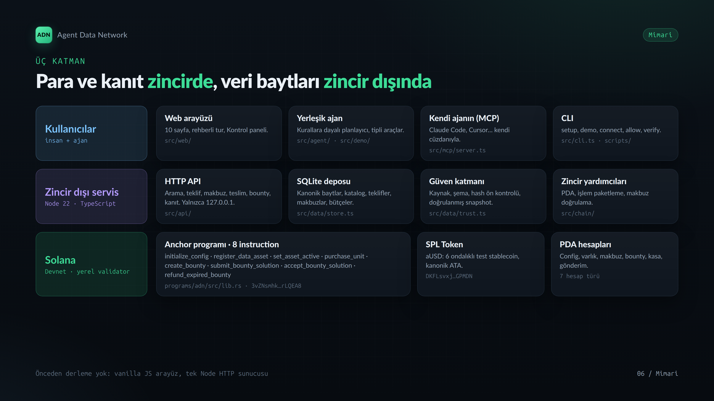

# 03 · Teknik mimari

## Temel fikir

**Para ve kanıt zincirde, veri baytları zincir dışında.**

- Solana'da yalnızca **şartlar** (fiyat, sürüm, hash'ler), **ödemeler** ve **makbuzlar** durur.
- Verinin kendisi (baytlar) ücretli içeriktir ve zincire yazılmaz. Çünkü zincir herkese açıktır; yazılsaydı herkes bedavaya okurdu. Ayrıca depolama pahalı olurdu.
- Zincirdeki **content hash** (SHA-256 parmak izi), zincir dışındaki baytların değişmediğini kanıtlamaya yeter.

## Katmanlar

### 1. Kullanıcı katmanı
| Parça | Dosya | Açıklama |
|---|---|---|
| Web arayüzü | `src/web/index.html`, `app.js`, `app.css`, `tour.js` | Vanilla JS, derleme adımı yok. 10 sayfa: Overview, Control, Agent workspace, Data marketplace, Provider workspace, Data bounties, Transactions & receipts, Provider earnings, Verification & evidence, Your agent. Türkçe/İngilizce rehberli tur. |
| Yerleşik ajan | `src/agent/tools.ts`, `budget.ts`, `src/demo/orchestrator.ts` | Kurallara dayalı planlayıcı; yalnızca tipli araçlarla çalışır |
| MCP sunucusu | `src/mcp/server.ts` | Dış ajanlara (Claude Code, Cursor, Claude Desktop) aynı araçları stdio üzerinden verir |
| CLI | `src/cli.ts` | `bootstrap`, `search`, `demo`, `agent-wallet`, `connect`, `allow` |

### 2. Zincir dışı servis (Node 22, TypeScript)
| Parça | Dosya | Açıklama |
|---|---|---|
| HTTP API | `src/api/server.ts` | Tek Node HTTP sunucusu, yalnızca `127.0.0.1:8787`. Statik arayüz + `/api/v1/*` + `/api/demo/*` |
| Paylaşılan servis | `src/api/service.ts` | Teklif ön kontrolü, cüzdana bağlı teslim, bounty görünümleri |
| Veri deposu | `src/data/store.ts`, `schema.sql`, `migrations/` | SQLite (better-sqlite3): kanonik baytlar, katalog, teklifler, makbuzlar, meydan okumalar, bounty'ler, teslim günlüğü, bütçeler, ajan hesapları |
| Güven katmanı | `src/data/trust.ts` | Girdi doğrulama, güven kaydı (sidecar), varlık başına doğrulanmış snapshot (0600, repo dışında), birebir bayt kurtarma, köken (kopya) tespiti |
| Zincir yardımcıları | `src/chain/adn.ts`, `ops.ts`, `verify.ts` | PDA türetme, işlem paketleme, kesinleşmiş makbuz doğrulayıcı, operatör işlemleri, makbuz öncelikli uzlaştırma, eski blockhash için yeniden deneme |
| İnceleme | `src/demo/review.ts` | Sınırlı bounty incelemesi (yalnızca geçti/kaldı) |

### 3. Solana katmanı
| Parça | Açıklama |
|---|---|
| Anchor programı | `programs/adn/src/lib.rs`, 768 satır Rust, 8 instruction, 19 özel hata. Ayrıntı: [04-solana-programi.md](04-solana-programi.md) |
| SPL Token | aUSD: 6 ondalıklı **legacy** SPL mint, kanonik ATA'lar |
| IDL | `idl/adn.json`, `adn.ts`, `adn_errors.ts` (Anchor tarafından üretildi) |

## HTTP API uçları

| Yöntem | Yol | Ne yapar | Ücretli içerik döner mi? |
|---|---|---|---|
| GET | `/api/v1/health` | Ağ, program, mint, RPC durumu | Hayır |
| GET | `/api/v1/connect` | Ajan bağlama bilgisi (cluster, klasör, anahtar yolu, MCP komutu) | Hayır |
| GET | `/api/v1/agents` | Bağlı MCP ajanları, harcama hakları, bekleyen istekler, aktivite | Hayır |
| POST | `/api/v1/agents/{buyer}/requests/{id}` | İnsan bir isteği onaylar/reddeder (yalnızca tarayıcıdan, aynı köken) | Hayır |
| GET | `/api/v1/assets` | Metadata araması (sorgu, etiket) | Hayır |
| GET | `/api/v1/catalog` | Tüm katalog + güven görünümü | Hayır |
| POST | `/api/v1/quotes` | Kesin teklif, ön kontrolle | Hayır |
| GET | `/api/v1/receipts/{pda}` | Makbuzu zincirden çözüp doğrular | Hayır |
| POST | `/api/v1/challenges` | Teslim için tek kullanımlık mesaj (60 sn) | Hayır |
| POST | `/api/v1/deliveries` | İmza + makbuz karşılığında **tam baytlar** | **Evet, yalnızca burada** |
| GET | `/api/v1/bounties`, `/bounties/{pda}` | Ödüller, kasa bakiyesi, gönderimler | Hayır (cevap yok) |
| GET | `/api/v1/evidence` | Kanıt dosyaları özeti | Hayır |
| GET/POST | `/api/demo/*` | Rehberli oturum: sahneler, yeni oturum, adım ilerletme, kanıt | Hayır; yalnızca loopback, aynı köken, oturum token'ı |

## Veri tabanı tabloları

`assets`, `quotes`, `receipts`, `challenges`, `bounties`, `submissions`, `delivery_log`, `asset_trust`, `agent_runs`, `spend_reservations`, `demo_runs`, `agent_grants`, `agent_requests`, `agent_activity`.

- Teklif durumları: `QUOTED`, `PENDING`, `FINALIZED`, `FAILED`, `UNKNOWN`.
- Bounty durumları: `OPEN`, `ACCEPTED`, `REFUNDED`.
- Teslim sonuçları: `VERIFIED`, `UNAVAILABLE`, `HASH_MISMATCH`.

## Anahtarlar nerede?

| Ne | Nerede | Repo'da mı? |
|---|---|---|
| Deployer, sağlayıcılar, hazine, alıcı, talep sahibi | `~/.config/adn-demo/keys/` (0600) | Hayır |
| Oturum cüzdanları | `~/.config/adn-demo/runs/<cluster>/<runId>/` (0600) | Hayır |
| Snapshot'lar | `~/.config/adn-demo/snapshots/<cluster>/` | Hayır |
| MCP ajan cüzdanı | `~/.config/adn-agent/<cluster>/agent.json` (0600) | Hayır |
| Program anahtar çifti | `target/` (git'te yok sayılıyor) | Hayır |

Git geçmişi tarandı: hiçbir revizyonda 64 baytlık anahtar dizisi, API anahtarı ya da özel anahtar bloğu yok.

## Teknoloji yığını (sabitlenmiş sürümler)

| Bileşen | Sürüm |
|---|---|
| Solana CLI (Agave) | 4.1.2 |
| Anchor CLI / anchor-lang / anchor-spl | 1.2.2 |
| Rust (program) | 1.89.0 (`rust-toolchain.toml`) |
| platform-tools | v1.57 |
| Node | 22 |
| @anchor-lang/core | 1.2.2 |
| @solana/web3.js | 1.99.0 |
| @solana/spl-token | 0.4.15 |
| @modelcontextprotocol/sdk | 1.32.2 |
| better-sqlite3 | 13.2.0 |
| tweetnacl | 1.0.3 (cüzdan imzalı teslim) |
| zod | 4.1.12 (MCP girdi şemaları) |
| playwright-core | 1.65.1 (tarayıcı testi, sistem Chrome'u) |
| mocha / chai / ts-mocha / tsx / typescript | test ve çalıştırma |

Eşleşme gerekçesi: resmî Solana geliştirici skill'inin uyumluluk matrisinde Anchor 1.2.x ↔ Solana CLI 4.1.x (CI'da 4.1.2 test edilmiş), MSRV 1.89.

## Komutlar

| Komut | Ne yapar |
|---|---|
| `npm run setup` | Bir kerelik kurulum ve tam sıfırlama: anahtarları üretir (silmez), programı derler, temiz yerel validator başlatır, aUSD mint'i ve config'i kurar |
| `npm start` | Validator'ü (durum korunur) ve web uygulamasını başlatır → http://127.0.0.1:8787 |
| `npm run demo` | Aynı ajan görevini başsız çalıştırır, `evidence/runs/` altına yazar |
| `npm test` | Rust + izole validator'de program testleri + uygulama/API/MCP + tarayıcı testi → `evidence/test-summary.json` |
| `npm run verify` | Son oturumdaki her işlemi ve makbuzu zincirde yeniden kontrol eder |
| `npm run devnet` | Program yoksa yükler, yüklenen baytların `adn.so` ile aynı olduğunu kontrol eder, mint/config kurar, tüm görevi Devnet'te çalıştırır ve doğrular |
| `npm run start:devnet` | Aynı arayüzü Devnet'e karşı açar (8787 portunu önce boşaltır) |
| `npm run verify:devnet` | Son Devnet oturumunu yeniden kontrol eder |
| `npm run mcp` | MCP sunucusunu başlatır (stdio) |
| `npm run connect` | Ajan cüzdanı + bütçe + Claude Code'a `adn` MCP kaydı |
| `npm run cli -- allow 0.5` | İnsan, ajana 0.5 aUSD'lik yeni harcama hakkı verir |
| `npm run export:public` | Son tam Devnet oturumundan salt okunur `public/` kopyasını üretir (ücretli içerik gizlenir, sızıntı kontrolü yapılır) |

## Önemli tasarım kararları

| Karar | Neden |
|---|---|
| Next.js yerine tek Node sunucusu + vanilla JS | Derleme adımı yok, daha az bağımlılık, hackathon hızı |
| Simülasyon modu yok | Arayüz asla uydurma veri göstermez; her sayı gerçek oturum durumundan gelir |
| x402 kullanılmadı | Standart x402 "exact SVM" kolaylaştırıcısı yalnızca ComputeBudget, TransferChecked ve Memo talimatlarına izin veriyor; özel bir Anchor programının iki `purchase_unit` talimatını doğrulayamaz. Sahte "x402" etiketi konmadı |
| Her oturum için yeni cüzdanlar | Oturumlar birbirinden izole; yeniden sıfırlama anahtar silmez |
| Validator tam geçmiş tutar (`--limit-ledger-size 50000000`) | Kaydedilen her imza sonradan doğrulanabilsin. Ledger saatte ~5 GB büyür; `ADN_LEDGER_SHREDS` ile düşürülebilir |
| Devnet için tempolu RPC katmanı | Herkese açık Devnet RPC'si 429 ile sınırlıyor; tek paylaşılan, geri çekilmeli (backoff) fetch |
| Eski blockhash için yeniden deneme | 24 kaydın paralel gönderiminde blockhash bayatlıyordu; Devnet'te eşzamanlılık 4 + `sendWithRetry` |
