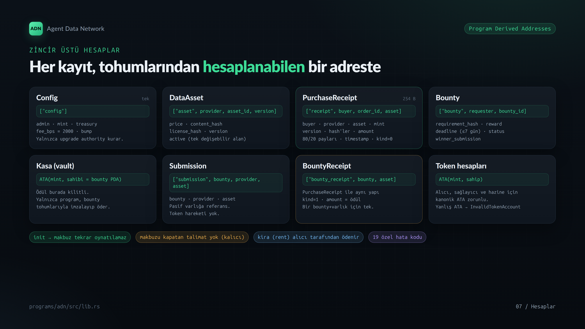

# 04 · Solana programı (Anchor)

- **Dosya:** `programs/adn/src/lib.rs` (Rust, Anchor 1.2.2)
- **Program ID:** `3vZNsmhko4nWqmFbAehmdwRmKLMyusqEPZCLP4rLQEA8` ([Explorer](https://explorer.solana.com/address/3vZNsmhko4nWqmFbAehmdwRmKLMyusqEPZCLP4rLQEA8?cluster=devnet))
- **Derlenmiş boyut:** `adn.so` yaklaşık 371 KB (370 960 bayt)
- **Devnet'teki baytlar yereldekiyle birebir aynı:** sha256 `94bb22a4…bbe687`
- **Upgrade authority:** demo deployer `Cu7ctAUxW25GsGGPVvNupujU81A9jvEZUGjo2sUdgVZ7`
- **ABI V1.3'ten beri değişmedi**: V1.5'teki bütün yeni özellikler (güven katmanı, yeniden satış, MCP) programa dokunmadan yapıldı.

## Sabitler

| Sabit | Değer | Anlamı |
|---|---|---|
| `FEE_BPS` | 2000 | Platform payı %20 (10 000 baz puan üzerinden) |
| `MINT_DECIMALS` | 6 | Yalnızca 6 ondalıklı mint kabul edilir |
| `MAX_BOUNTY_DURATION_SECS` | 604 800 | Ödül süresi en fazla 7 gün |
| `KIND_PURCHASE` / `KIND_BOUNTY` | 0 / 1 | Makbuz türü |
| `BOUNTY_OPEN` / `ACCEPTED` / `REFUNDED` | 0 / 1 / 2 | Ödül durumu |

## Bölüşüm formülü

```
platform  = floor(tutar × 2000 / 10000)
sağlayıcı = tutar − platform      (sağlayıcı > 0 olmak zorunda)
```

| Tutar (baz birim) | Sağlayıcı | Platform |
|---|---|---|
| 30 000 (0.03 aUSD) | 24 000 | 6 000 |
| 30 001 | 24 001 | 6 000 |
| 2 000 000 (2 aUSD) | 1 600 000 | 400 000 |
| 5 | 4 | 1 |
| 4 | 4 | 0 |
| 1 | 1 | 0 |
| u64::MAX | toplam taşmasız korunur | |

Hesap `u128` ile yapılır ve taşma kontrol edilir (`checked_mul`, `checked_div`, `checked_sub`). Yuvarlama artığı **sağlayıcının lehinedir**.

## 8 instruction

| # | Instruction | Kim imzalar | Ne yapar | Önemli kontroller |
|---|---|---|---|---|
| 1 | `initialize_config(treasury)` | Programın upgrade authority'si | Tek seferlik ayar: admin, mint, hazine, fee_bps | ProgramData'daki upgrade authority = imzalayan; mint 6 ondalıklı; hazine sıfır adres değil; PDA `init` olduğu için ikinci çağrı başarısız |
| 2 | `register_data_asset(asset_id, version, content_hash, license_hash, price, active)` | Sağlayıcı | Versiyonlu, değiştirilemez veri listelemesi | sürüm ≥ 1, fiyat > 0 ve sağlayıcı payı > 0, hash'ler sıfır değil, sağlayıcı ≠ hazine |
| 3 | `set_asset_active(active)` | Yalnızca o varlığın sağlayıcısı | Satışı açar/kapatır | `has_one = provider`; başka hiçbir alan değiştirilemez |
| 4 | `purchase_unit(order_id, expected_price, expected_content_hash, expected_license_hash, expires_at)` | Alıcı | %80 sağlayıcıya, %20 hazineye; makbuz yazar | süre dolmadı, varlık aktif, imzalanan şartlar zincirdekiyle aynı, alıcı/sağlayıcı/hazine farklı, bakiye yeterli, mint = config mint, kanonik ATA'lar |
| 5 | `create_bounty(bounty_id, requirement_hash, reward, deadline)` | Talep sahibi | Ödülü PDA kasasına kilitler | son süre gelecekte ve ≤ 7 gün, ödül > 0, gereksinim hash'i sıfır değil, talep sahibi ≠ hazine, bakiye yeterli |
| 6 | `submit_bounty_solution()` | Sağlayıcı | Pasif bir varlığı aday olarak bağlar; para yok | ödül açık, süre dolmadı, varlık **pasif**, sağlayıcı ≠ talep sahibi ve ≠ hazine, varlığın sahibi sağlayıcı |
| 7 | `accept_bounty_solution(expected_requirement_hash, expected_content_hash, expected_license_hash)` | Talep sahibi | Kasadan 80/20 öder, bounty makbuzu yazar, durumu ACCEPTED yapar | `has_one = requester`, ödül açık, süre dolmadı, hash'ler beklenenle aynı, gönderim bu ödüle/varlığa/sağlayıcıya ait, kasada ≥ ödül |
| 8 | `refund_expired_bounty()` | Talep sahibi | Ödülün tamamını komisyonsuz iade eder, durumu REFUNDED yapar | ödül açık, `now ≥ deadline`, kasada ≥ ödül |

## Hesaplar (PDA'lar)



| Hesap | Tohumlar (seeds) | Alanlar |
|---|---|---|
| Config | `["config"]` | admin, mint, treasury, fee_bps, bump |
| DataAsset | `["asset", provider, asset_id(16 B), version(u32 LE)]` | provider, asset_id, version, content_hash, license_hash, price, active, bump |
| PurchaseReceipt | `["receipt", buyer, order_id(16 B), asset]` | buyer, provider, asset, mint, order_id, version, content_hash, license_hash, amount, provider_amount, platform_amount, timestamp, kind, bump (**254 bayt**, discriminator dahil) |
| Bounty | `["bounty", requester, bounty_id(16 B)]` | requester, bounty_id, requirement_hash, reward, deadline, status, winner_submission, bump |
| Vault | ATA(mint, sahip = bounty PDA) | Token hesabı |
| Submission | `["submission", bounty, provider, asset]` | bounty, provider, asset, bump |
| BountyReceipt | `["bounty_receipt", bounty, asset]` | PurchaseReceipt ile aynı yapı, kind = 1 |

**Neden PDA?** PDA'nın özel anahtarı yoktur; yalnızca program, tohumlarla "imzalayabilir". Bu yüzden kasadan parayı programın kuralları dışında kimse çıkaramaz. Ayrıca adresler tohumlardan hesaplanabilir, yani bir makbuzun gerçekten o alıcı, o sipariş ve o varlık için yazıldığı doğrulanabilir.

**Tekrar oynatma koruması:** Makbuz `init` ile açılır. Aynı alıcı + order ID + varlık için ikinci kez açılamaz (T14).

**Kira (rent):** Makbuz hesabının kirasını alıcı öder (`payer = buyer`). Yerelde ölçülen makbuz kirası 2 658 720 lamport. Makbuzu kapatan bir talimat yoktur; makbuzlar kalıcıdır (kira geri alınmaz). Bu, ölçeklenmede maliyet konusudur; bkz. [07-is-modeli-ve-pazar.md](07-is-modeli-ve-pazar.md).

## 19 özel hata

| Hata | Mesaj (özet) |
|---|---|
| `UnauthorizedInitializer` | İmzalayan upgrade authority değil |
| `Unauthorized` | Yetkisiz imzalayan ya da rol |
| `InvalidMint` | Mint, ayarlı 6 ondalıklı legacy mint değil |
| `InvalidTokenAccount` | Token hesabı beklenen sahibin kanonik ATA'sı değil |
| `InvalidTerms` | İmzalanan şartlar zincirdeki varlıkla eşleşmiyor |
| `InactiveAsset` | Varlık pasif |
| `InvalidPrice` | Fiyat/ödül sıfır ya da sağlayıcı payı sıfır |
| `ExpiredQuote` | Teklifin süresi doldu |
| `DuplicateReceipt` | Makbuz zaten var |
| `InsufficientFunds` | Yetersiz bakiye |
| `ArithmeticOverflow` | Aritmetik taşma |
| `InvalidDeadline` | Son süre geçmişte ya da 7 günden uzak |
| `InvalidSubmission` | Gönderim bu ödül/varlık/sağlayıcı ile eşleşmiyor |
| `BountyNotOpen` | Ödül açık değil |
| `DeadlinePassed` | Ödülün süresi geçti |
| `DeadlineNotReached` | Süre henüz dolmadı (erken iade) |
| `HashMismatch` | Hash uyuşmuyor ya da sıfır hash |
| `InvalidVersion` | Sürüm ≥ 1 olmalı |
| `AliasedAccounts` | Alıcı/sağlayıcı/hazine/talep sahibi aynı olamaz |

## Ölçülen performans

| İşlem | Boyut | Hesaplama (CU) | Ücret |
|---|---|---|---|
| 2 × `purchase_unit` (atomik paket) | 784 bayt (sınır 1232) | ~54 000 – 64 000 | 5 000 lamport |
| Yeniden satış (1 × `purchase_unit`) | 571 bayt | ~25 000 | 5 000 lamport |

## Deploy maliyeti

- Program kirası (ProgramData): **1.88535564 SOL** (kalıcı, programın boyutuna bağlı).
- Deploy sırasında aynı büyüklükte geçici bir buffer açılır; deploy bitince kapanır ve iade edilir.
- Her yeni Devnet oturumu deployer'dan yaklaşık **0.15 SOL** harcar (sağlayıcı kiraları ve 3 oturum cüzdanı).
- Kurucu 5 Devnet SOL ile fonladı; ilk deploy + oturumdan sonra 2.75 SOL kalmıştı.
- İlk deploy denemesi `--use-rpc` ayarı yüzünden herkese açık RPC'nin sınırına takıldı ve 40 dakika ilerlemedi. Buffer kapatıldı, 1.885 SOL geri alındı ve işlemler doğrudan validator'lere (TPU) gönderilerek tekrar yüklendi.

## Programın kanıtlamadığı şeyler (kod yorumunda da yazıyor)

> "A receipt proves paid entitlement to a hash/version/license only. It does not prove truth, ownership, delivery or consumption of the data."

Program şunları uygulamaz ve uygulayamaz: verinin doğruluğu, sağlayıcının veri sahibi olduğu, verinin teslim edildiği, ödül incelemesinin sonucu (bunu talep sahibinin imzası temsil eder).
