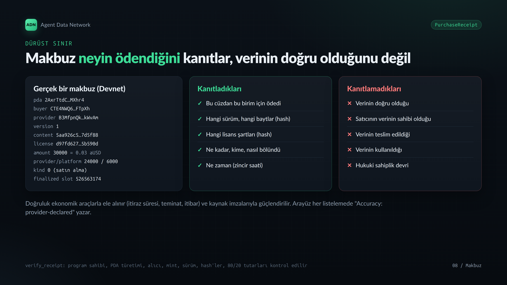
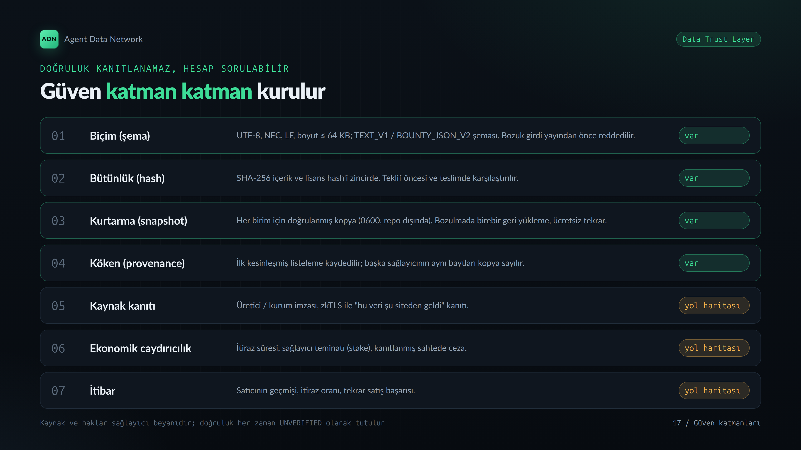
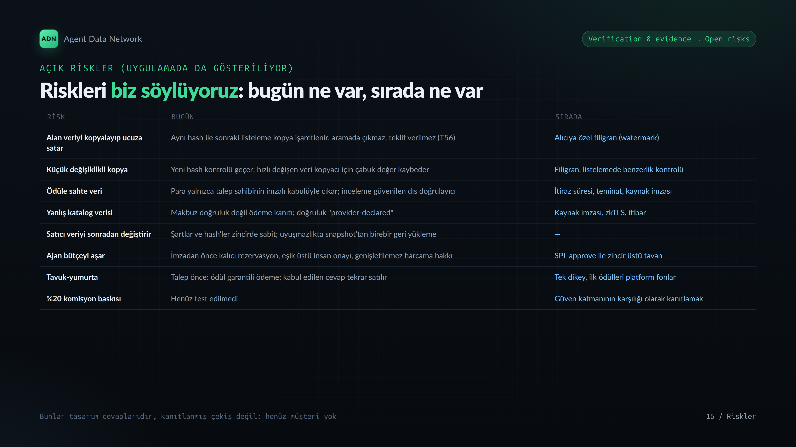

# 05 · Güvenlik, güven ve riskler

## 1. Zincir üstü güvenlik (programın zorladıkları)

| Tehdit | Program ne yapar | Test |
|---|---|---|
| Yetkisiz biri config'i kurar | Yalnızca ProgramData'daki upgrade authority kurabilir; ikinci kurulum `init` yüzünden başarısız | T04 |
| Yanlış ondalıklı mint ile kurulum | 6 ondalık değilse `InvalidMint` (9 ondalıklı mint reddedildi) | T04 |
| Satıcı listelemeden sonra fiyatı/hash'i değiştirir | Varlıkta yalnızca `active` değiştirilebilir; fiyat ve hash'ler değişmez. Yeni şart = yeni sürüm = yeni PDA | T05 |
| Sıfır fiyat, sıfır hash, sürüm 0, hazinenin satıcı olması | Reddedilir | T06 |
| Alıcı teklif aldıktan sonra fiyat değişir | Alıcı beklenen fiyat ve hash'leri imzalar; uyuşmazsa `InvalidTerms` | T16 |
| Eski teklifin kullanılması | `expires_at` geçtiyse `ExpiredQuote` | T16 |
| Aynı siparişin tekrar oynatılması | Makbuz `init`; ikinci kez açılamaz, para hareket etmez | T14 |
| Yanlış mint / sahte token hesabı | Mint config'deki mint olmalı; hesaplar kanonik ATA olmalı | T15 |
| Alıcının kendine ödemesi (alias) | Alıcı, satıcı ve hazine aynı olamaz (`AliasedAccounts`) | T15 |
| Paketin yarısının geçmesi | Tek işlem atomik; ikinci talimat bozuksa hepsi geri alınır | T13, T17 |
| Satıcının ödülü kendi kendine alması | Kasadan para yalnızca talep sahibinin imzalı kabulüyle çıkar | T28 |
| Ödülün iki kez ödenmesi | Durum ACCEPTED olunca ikinci kabul ve iade reddedilir | T30 |
| Erken iade | `DeadlineNotReached` | T29 |
| Geç kabul | `DeadlinePassed` | T29 |
| Kasaya dışarıdan "toz" göndererek karışıklık | Kasadan yalnızca `reward` çıkar; fazlası kalır | T31 |
| Aktif (satışta olan) varlığı aday göstermek | Gönderim yalnızca pasif varlık kabul eder | T26 |

## 2. Zincir dışı güvenlik (servisin zorladıkları)

| Tehdit | Önlem | Test |
|---|---|---|
| Makbuzsuz / sahte makbuzlu / başka alıcının makbuzuyla veri almak | `/deliveries` kesinleşmiş makbuz + o makbuzun alıcısının taze imzasını ister | T18 |
| İmzalı isteğin tekrar kullanılması | Nonce tek kullanımlık, 60 sn geçerli | T19 |
| Ücretli içeriğin başka uçlardan sızması | Arama, katalog, bounty, sağlık, kanıt ve loglar içerik ya da cevap içermez | T41/T50 |
| Ödemeden sonra verinin bozulması | Teslim kapalı başarısız; snapshot'tan birebir geri yükleme, ücretsiz tekrar | T20/T43 |
| Bozuk veriye teklif verilmesi | Ön kontrol: bozuk bayt → 422, snapshot yok → 503 | T42 |
| Bozuk/kanonik olmayan girdinin yayınlanması | UTF-8, NFC, LF, ≤ 64 KB, şema kontrolü yayından önce | T40 |
| Satılık listelemenin geri çekilmesi | Önceki alıcıların hakkı korunur; pasifken yeni satış yok | T43 |
| Bekleyen (PENDING) teklif | Zincirden kesinleşmiş olarak uzlaştırılır; yeni sipariş açılmaz | T21 |
| Aşırı büyük arama/teklif | Sınırlar ve red | T22 |
| Ajanın bütçeyi aşması | İmzadan önce SQLite'ta kalıcı rezervasyon; bekleyenler de sayılır; oturum başına en fazla 1 bounty; politika genişletilemez | T47 |
| Ajanın keyfi imza atması | Tipli araçlarda `sign`/`transfer` adlı araç yok (test bunu tarar) | T46, T54 |
| Demo uçlarının kötüye kullanımı | Yalnızca loopback, aynı köken, oturum token'ı, adım adım; anahtar/işlem/alıcı kabul etmez | "demo API guards" |
| Dizin dışına çıkma (path traversal) | Statik dosya sunumunda engellenir | "demo API guards" |
| Kopya listeleme | Başka satıcının daha önce listelediği aynı baytlar kopya işaretlenir, teklif verilmez (`DUPLICATE_CONTENT`) | T56 |
| Ajan onayının ajan tarafından verilmesi | Onay uç noktası yalnızca tarayıcıdan (aynı köken) kabul eder; komut satırından istek 403 | MCP uçtan uca testi |

## 3. Güven varsayımları (açıkça yazılı)

README'de ve uygulamada yazdığımız varsayımlar:

1. **Program, demo deployer tarafından yükseltilebilir.** Gerçek üründe multisig / zaman kilidi gerekir.
2. **Bounty incelemesi zincir dışında, güvenilen bir doğrulayıcıdır.** Program bunu zorlayamaz; talep sahibinin imzası kararı temsil eder.
3. **Ödeme atomiktir ama teslim ayrı bir adımdır.** Teslim tekrar denenebilir ve kurtarılabilir, fakat ödeme ile teslim aynı işlemde değildir ("fair exchange" iddiası yok).
4. **Makbuz, belirli baytlara, sürüme ve lisansa ödenmiş hakkı kanıtlar; doğruluğu, sahipliği ya da kullanımı kanıtlamaz.**
5. **Kaynak ve haklar sağlayıcı beyanıdır.** Doğruluk her zaman `UNVERIFIED` tutulur; arayüzde "Accuracy: provider-declared".
6. **MCP ajan anahtarı yerel bir dosyadadır (0600).** Onaylar ajan hatalarına karşı korur; makineye tam erişimi olan biri dosyayı okuyabilir.

## 4. Güven katmanları

| Katman | Ne yapar | Bugün |
|---|---|---|
| Biçim (şema) | Beklenen yapıya uyuyor mu | Var |
| Bütünlük (hash) | Teslim edilen bayt ödenenle aynı mı | Var |
| Kurtarma (snapshot) | Bozulmada birebir geri yükleme | Var |
| Köken (provenance) | İlk listeleyen kim, kopya mı | Var |
| Kaynak kanıtı | Kaynak imzası, zkTLS | Yol haritası |
| Ekonomik caydırıcılık | Teminat, itiraz süresi, ceza | Yol haritası |
| İtibar | Satıcı geçmişi, itiraz oranı | Yol haritası |

"Veri doğru mu?" sorusu genel olarak hiçbir sistemde kanıtlanamaz. Doğru hedef **hesap sorulabilirlik**: kim, ne zaman, hangi baytları, hangi şartlarla sattı; yanlış çıkarsa bedelini kim öder.

## 5. Açık riskler tablosu

Bu tablo uygulamada **Verification & evidence → Open risks** altında da görünür.

| Risk | Bugün | Sırada |
|---|---|---|
| Alıcı veriyi kopyalayıp ucuza satar | Her listelemenin içerik hash'i zincirde. Başka satıcının sonraki aynı bayt listelemesi kopya işaretlenir, aramadan gizlenir, teklif reddedilir (T56). İlk listelemenin slotu ve kopyacının kendi makbuzu kimin önce listelediğini gösterir. Lisans hash'i şartları kayda geçirir. | Alıcıya özel filigran: sızıntı hangi makbuzdan çıktığını gösterir |
| Küçük değişiklikli kopya | Yeni bayt = yeni hash, kopya kontrolünü geçer. Hızlı değişen veri (fiyat, stok, teslim süresi) kopyacı için çabuk değer kaybeder | Filigran, listelemede benzerlik kontrolü |
| Ödüle sahte veri | Kasa yalnızca talep sahibinin imzalı kabulüyle ve yalnızca ödül tutarı kadar öder; sağlayıcı kendine ödeyemez. Talep sahibi ödemeden önce yalnızca geçti/kaldı görür. İnceleme güvenilen bir doğrulayıcı | Ödeme öncesi itiraz süresi; kanıtlanmış sahtede kaybedilen teminat; zincirde kontrol edilen kaynak imzalı cevaplar |
| Yanlış ya da uydurma katalog verisi | Makbuz neyin ödendiğini kanıtlar, doğru olduğunu değil. Kaynak ve doğruluk sağlayıcı beyanı olarak etiketlenir | Kaynak imzaları, zkTLS, itiraz geçmişinden itibar |
| Satıcı ödemeden sonra veriyi değiştirir | Şartlar ve hash'ler zincirde sabit; uyuşmazlıkta teslim kapanır ve snapshot'tan birebir geri yüklenir | — |
| Tavuk-yumurta (alıcı yoksa satıcı yok, satıcı yoksa alıcı yok) | Talep önce gelir: ödül, eksik cevabı kilitli ve garantili ödemeye çevirir; veri ancak parası hazırsa üretilir. Kabul edilen cevaplar kataloğa girer ve yeniden satılır. Herhangi bir MCP ajanı tek satırla alıcı olabilir | Tek dikeyle başlamak (ekipman tedarik verisi) ve ilk ödülleri platformun fonlaması |

> Bunlar tasarım cevaplarıdır, kanıtlanmış çekiş değil: henüz müşteri yok.

## 6. Bağımlılık uyarıları

`npm audit --omit=dev`, Solana JS yığınının dolaylı bağımlılıklarında bilinen uyarılar gösteriyor: `bigint-buffer` (spl-token üzerinden), `toml` (@anchor-lang/core), `stream-json` (web3.js/jayson). Kırılmayan bir düzeltmesi yok. Uygulama yalnızca loopback'te çalışıp yalnızca yerel, güvenilen girdileri işlediği için risk sınırlı. PROJECT-STATE.md'de kayıtlı.

## 7. Canlı kopya neden salt okunur?

Tam uygulama sağlayıcı ve platform (operatör) anahtarlarını tutar. Bunu herkese açık bir sunucuya koymak güvenli olmaz. Vercel'deki kopya:
- son tamamlanmış Devnet oturumunun yakalanmış JSON'unu okur,
- ücretli içeriği gizler ("yalnızca makbuz sahibine teslim edilir"),
- imza atan bütün düğmeleri kapatır, üstte "PUBLIC COPY · read-only" yazar,
- dışa aktarma betiği yazmadan önce sızıntı kontrolü yapar,
- yerel dosya yollarını temizler.
