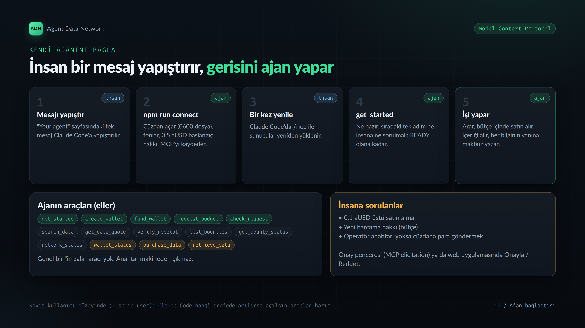

# 06 · Ajanlar ve MCP

## "Ajan" ne demek?

**Ajan**, yalnızca sohbetle cevap veren değil, **kendi başına iş yapabilen** bir yapay zekâ programıdır: komut çalıştırır, araç kullanır, bir görevi adım adım bitirir.

Projede iki tür ajan var:

| | Yerleşik ajan | Senin ajanın (MCP ile) |
|---|---|---|
| Ne | Uygulamanın içindeki "Research agent" | Claude Code, Claude Desktop, Cursor ya da herhangi bir MCP istemcisi |
| Zekâ | **Kurallara dayalı planlayıcı**, LLM değil | Gerçek bir LLM (örneğin Claude) |
| Amaç | Sistemin baştan sona çalıştığını deterministik olarak göstermek (16 adım) | Pazarın gerçek bir ajan tarafından kullanılabildiğini göstermek |
| Cüzdan | Oturum başına yeni cüzdan, `~/.config/adn-demo/runs/...` | Makine başına tek cüzdan, `~/.config/adn-agent/<cluster>/agent.json` |
| Bütçe | 2.1 aUSD tavan, en fazla 1 ödül | İnsanın onayladığı harcama hakları (varsayılan 0.5 aUSD) |
| Ödül açabilir mi? | Evet (1 kez) | Hayır; `list_bounties` ile görebilir |

Neden yerleşik ajan LLM değil? Ana demoya bir API anahtarı ve öngörülemezlik eklememek için. Jüriye gösterilen 16 adım her seferinde aynı sonucu vermeli. LLM tarafı MCP ile ayrıca gösteriliyor. Bu ayrım demo videosu ve README'de açıkça söyleniyor.

## MCP nedir?

**Model Context Protocol (MCP)**, yapay zekâ asistanlarının dış araçlara bağlandığı standart bir "prizdir". Claude, Cursor gibi araçlar bu prizi tanır.

**ADN bir MCP değildir; bir veri pazarıdır.** MCP yalnızca fiş. Biz, pazarımıza takılmak için bir MCP sunucusu yazdık (`src/mcp/server.ts`, sürüm 0.3.0, stdio taşıması).

`npm run connect` sunucuyu Claude Code'a **kullanıcı düzeyinde** (`--scope user`) kaydeder. Yani bir kez kurduktan sonra Claude Code'u hangi projede açarsan aç, araçlar orada. Başka bir projede kod yazarken "şu parçanın teslim süresini bul" dersen Claude pazara gidip veriyi satın alabilir.

## Kurulum: insan bir mesaj yapıştırır, gerisini ajan yapar

1. Uygulamada **Your agent** sayfasını aç, tek mesajı kopyala, Claude Code'a yapıştır.
2. Ajan `npm run connect` çalıştırır (Devnet için `SOLANA_CLUSTER=devnet` ekler). Bu komut:
   - bu makinede bir cüzdan oluşturur (anahtar dosyası 0600, makineden çıkmaz; varsa korur),
   - operatör anahtarları bu makinedeyse cüzdanı fonlar (varsayılan hedef 1 aUSD; SOL 0.02'nin altındaysa Devnet'te deployer'dan 0.05 SOL, yerelde 1 SOL airdrop),
   - 0.5 aUSD başlangıç harcama hakkı ve 0.1 aUSD onay eşiği tanımlar,
   - `adn` MCP sunucusunu Claude Code'a kaydeder.
   Tekrar çalıştırmak güvenlidir.
3. Ajan senden bir kez MCP sunucularını yenilemeni ister (Claude Code: `/mcp` ya da yeni oturum).
4. Ajan `get_started` aracını çağırır: neyin hazır olduğunu, sıradaki tek adımı ve yalnızca insanın yapabileceği işleri söyler. Ajan `READY` olana kadar kendisi ilerler.
5. İsteğin üzerinde çalışır: arar, harcama hakkı içinde satın alır, her bilginin yanına makbuz adresini yazar.

Ayar değiştirmek: `npm run connect -- --allowance 1 --approve-above 0.2`.

## Araçlar (14 araç + 2 hazır prompt)

| Araç | Tür | Ne yapar |
|---|---|---|
| `get_started` | kurulum | Durum (ağ, cüzdan, bakiye, hak, bekleyen onaylar), sıradaki tek adım, insana sorulacaklar |
| `create_wallet` | kurulum | Bu makinede cüzdan; varsa korur |
| `fund_wallet` | kurulum | Operatör anahtarı varsa en fazla 5 aUSD'ye kadar fonlar; yoksa insana ne gönderileceğini söyler (`NEEDS_HUMAN`) |
| `request_budget` | kurulum | İnsandan yeni harcama hakkı ister |
| `check_request` | kurulum | Bekleyen isteğin durumu: PENDING, APPROVED, DECLINED, USED |
| `network_status` | açık | Cluster, program, mint, hazine, RPC sağlığı |
| `search_data` | açık | Ücretsiz metadata araması; içerik asla dönmez; gerekli etiket yoksa "gap" bildirir |
| `get_data_quote` | açık | Güven ön kontrollü kesin teklif; imza/ödeme yok |
| `verify_receipt` | açık | Makbuzu zincirde doğrular (sahip, PDA, alıcı, mint, sürüm, hash'ler, 80/20) |
| `list_bounties`, `get_bounty_status` | açık | Ödüller, canlı kasa bakiyesi, durum; cevap içermez |
| `wallet_status` | cüzdan | Adres, aUSD/SOL, harcanan/kalan, eşik, satın almalar, bekleyen istekler |
| `purchase_data` | cüzdan | 1–2 birimi tek işlemde alır: teklif + ön kontrol, hak kontrolü, eşik üstüyse insan onayı, imza, kesinleşme, makbuz doğrulama |
| `retrieve_data` | cüzdan | Cüzdanla tek kullanımlık mesajı imzalar, baytları alır, makbuzdaki hash ile kontrol eder |

Hazır promptlar: `get_started` ve `procurement_brief`. Sunucu ayrıca kullanım kurallarını **MCP instructions** olarak gönderir: önce `get_started`, satın almadan önce birkaç anahtar kelimeyle ara, tutarlar "0.05" gibi ondalık metin, aynı birimi iki kez alma, her bilginin yanında makbuz adresini belirt, veri uydurma, hak bitince `request_budget`.

**Genel bir imza aracı yoktur.** Test T54 araç listesinde `sign`, `transfer`, `send` geçen bir araç olmadığını kontrol eder.

## İnsana ne sorulur, nasıl sorulur?

| Durum | Ajan ne yapar |
|---|---|
| Satın alma toplamı onay eşiğinin üstünde (varsayılan 0.1 aUSD) | İnsandan onay ister |
| Harcama hakkı bitti | `request_budget` ile yeni hak ister |
| Bu makinede operatör anahtarı yok | İnsana cüzdana aUSD ve SOL göndermesini söyler |
| RPC'ye ulaşılamıyor | İnsana ağı kontrol etmesini ya da `npm start` demesini söyler |

**Nasıl:**
- İstemci MCP **elicitation** (onay penceresi) destekliyorsa insanın karşısına bir pencere çıkar (10 dakika zaman aşımı).
- Desteklemiyorsa istek, web uygulamasındaki **Your agent** sayfasında **Approve / Decline** düğmeleriyle bekler. Ajan `check_request` ile sonucu takip eder; onaylanan alımı aynı birimler ve `approvalId` ile tekrar çağırır.
- Onay yalnızca tarayıcıdan verilebilir; ajanın komut satırından gönderdiği onay isteği reddedilir (403).
- Onaylanan istek başka birimler ya da daha yüksek tutar için kullanılamaz (`NOT_APPROVED`). Fiyat değiştiyse hiçbir şey satın alınmaz (`PRICE_CHANGED`).

## Harcama hakları (allowance) nasıl çalışır?

- Her hak **sabit bir bütçedir**, kendiliğinden büyümez ve yerinde genişletilemez.
- Daha fazla bütçe = insanın onayladığı **yeni** bir hak (pencerede, web sayfasında ya da `npm run cli -- allow 0.5`).
- Önceki haklardan yapılan harcamalar sayılmaya devam eder.
- Her harcama imzadan **önce** SQLite'ta rezerve edilir (`spend_reservations`); bekleyen harcamalar da sayılır.
- Her hak ile 0.05 SOL'lük ücret/kira bütçesi de gelir.

## Your agent sayfası

- Ajanın cüzdanı ve kalan harcama hakkı (çubuk),
- onay eşiği,
- bekleyen onaylar (sarı "Waiting for you" kutusu),
- ajanın yaptığı her işin canlı akışı (her 5 saniyede yenilenir),
- katlanmış "Manual setup" bölümü (elle kurulum, araç listesi).

## Test edildi mi?

Evet. **T55** gerçek bir MCP istemcisiyle şu akışı uçtan uca dener: ajan sıfırdan cüzdan açar ve kendini fonlar; bütçe ister; insan web'den onaylar; eşiğin altındaki alım onaysız geçer; eşiğin üstündeki alım web'den reddedilir ve reddedilen onayla tekrar alım engellenir; onay penceresinden onaylanan alım geçer; içerik hash kontrolüyle alınır; hepsi aktivite akışında görünür.

## "Gerçekte de böyle mi olacak?" (cüzdan sorusu)

**Aynı kalanlar:**
- Ajanın kendine ait bir cüzdanı olması. Alışveriş yapacaksa imza atması gerekir.
- Anahtarın kullanıcının bilgisayarında durması ve sunucumuza hiç gitmemesi.
- Harcama hakkı, insan onayı, satın alma, makbuz, verinin yalnızca makbuz sahibine teslimi.

**Değişecekler:**
1. **Paranın kaynağı:** Bugün aUSD'yi operatör basıyor (test parası). Gerçekte kimse para basamaz; kullanıcı ajan cüzdanına kendi USDC'sini yatırır (örneğin Phantom'dan), tıpkı harçlık vermek gibi.
2. **Para birimi ve ağ:** aUSD yerine gerçek bir stablecoin (USDC), Devnet yerine mainnet.
3. **Sınırın korunduğu yer:** Bugün sınır bizim yazılımımızda. Daha güvenli yollar:
   - **Onay (delegate):** Para kullanıcının cüzdanında kalır; kullanıcı ajana zincirde "en fazla 5 USDC harcayabilirsin" izni verir (SPL `approve`). Sınırı Solana korur; yazılım hata yapsa bile aşılamaz.
   - **Yönetilen cüzdan:** Privy, Turnkey gibi servisler ajan için cüzdan açar ve harcama kurallarını kendi tarafında uygular.
4. **Kurulum:** Repo indirmek yerine tek satır: `claude mcp add adn -- npx agent-data-network-mcp` (npm paketi) ya da internetten bağlanılan uzak bir MCP sunucusu.

**Herkesin bilgisayarında mı çalışacak?** Hayır. Gerçek üründe:

| Parça | Bugün | Gerçek üründe |
|---|---|---|
| Solana programı | Devnet (herkese ortak) | Mainnet |
| Pazar servisi (katalog, veri dosyaları, teslim) | Kullanıcının bilgisayarında | İnternette tek merkezi sunucu (Railway/Fly.io/VPS; SQLite yerine Postgres). Vercel uygun değil çünkü sürekli çalışan süreç ve veritabanı gerekiyor |
| MCP sunucusu (ajanın eli + cüzdan imzası) | Repo klasöründen | **Yine kullanıcının bilgisayarında**, tek satırla kurulan küçük paket |
| Web arayüzü | Yerel + Vercel'de vitrin | İnternette, cüzdanla giriş |

Jüri için tek cümle: *"Today the whole stack runs on one machine for the demo. In production the marketplace is one hosted service plus the Solana program, and only the small MCP wallet client runs next to each user's agent, so keys never leave the user."*
