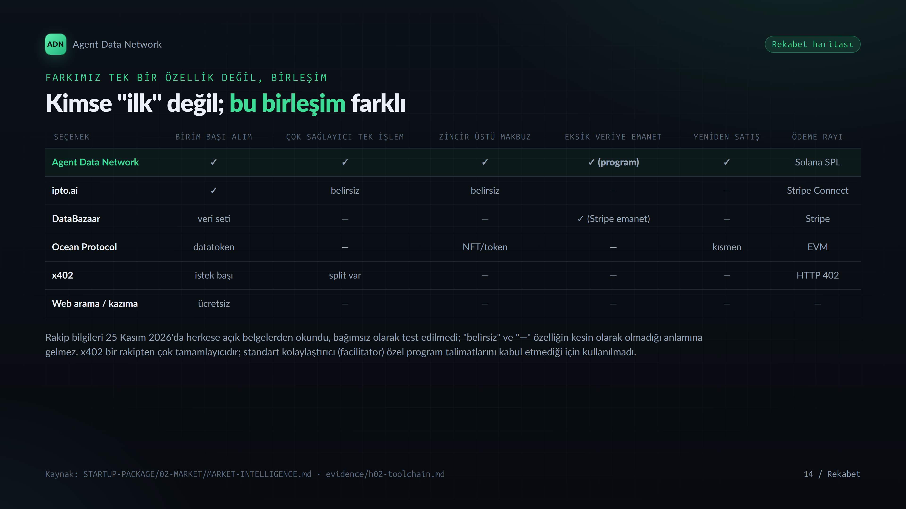

# 07 · İş modeli, pazar ve rekabet

## Konumlandırma

**Ana mesajda "data marketplace" demiyoruz.** Önerilen ifade:

> **"AI ajanları için lisanslı veri satın alma ve ispat altyapısı"** (*licensed data purchasing and proof rail for AI agents*).

Pazar yeri bir sonuç, ürün değil. Ürün: **ödeme + lisans + kanıt rayı**.

## Gelir modeli

| Kalem | Kural |
|---|---|
| Arama (metadata) | Ücretsiz |
| Veri birimi satışı | Sabit fiyat; %80 sağlayıcı, %20 platform, programda zorunlu |
| Ödül (bounty) | Talep sahibi fonlar; kabulde aynı 80/20 |
| Süresi dolan ödül | Tam iade, komisyon yok (iade gelir sayılmaz) |
| Listeleme ücreti, abonelik, token | Yok |
| Ağ ücretleri ve makbuz kirası | SOL olarak alıcı/talep sahibi öder, ayrı kalem |

Demo fiyatları: birimler 0.010–0.035 aUSD (ortalama ~0.0215), sipariş edilen sertifika 0.03, ödül 2 aUSD. Bunlar **test değerleridir**, dolar ya da gerçek gelir değildir. Formül: `fee = floor(amount × 2000 / 10000)`.

## Birim ekonomisi (senaryo, gerçek veri değil)

```
birim başı katkı = fiyat × komisyon × (1 − iade oranı)
                   − teslim/RPC maliyeti
                   − ücretsiz arama oranı × arama maliyeti
                   − platformun üstlendiği ücret/kira
                   − destek / dolandırıcılık karşılığı
```

- Katkı ≤ 0 ise hacim bunu düzeltemez.
- Katkı > 0 ise başa baş = sabit aylık maliyet / katkı.
- **Makbuz kirası:** her yeni makbuz kira-muaf olmak için SOL kilitler (yerelde 2 658 720 lamport ölçüldü). Bu yakılan ücret değil, kilitli depozit; ama makbuzu kapatan talimat olmadığı için geri alınmaz. Küçük alımlarda alıcının toplam maliyetini artırır. Toplu işlem ücreti düşürür ama makbuz başına depoziti düşürmez. İleride sıkıştırılmış (compressed) / Merkle makbuzlar ayrı tasarım ve denetim ister.

**Örnek ölçek senaryosu (pazar belgesinden, ölçülmüş değil):** 100 ulaşılabilir kuruluş × %10 benimseme × ayda 1 000 alım × 0.03 $ × 12 = yılda 3 600 $ GMV, 720 $ platform geliri. Bu bir TAM değildir; pazar büyüklüğü bilinmiyor.

## Ağ etkisi (flywheel)

Parası hazır eksik → yeni lisanslı veri → daha fazla başarılı satın alma → daha fazla sağlayıcı kazancı → daha fazla arz.

İzlenecek metrikler (etkinlik sonrası): bağımsız ödeyen alıcı tutunması, tekrar eden sağlayıcılar, karşılanan eksikler, ödül başına sonraki satışlar, net katkı, itiraz oranı, doğrulanmış makbuz kapsamı, alıcının gerçek toplam SOL maliyeti. **Etkinlik sırasında yalnızca test kanıtı var.**

## "Marketplace kötü bir girişim modeli değil mi?"

Haklı bir itiraz. Pazar yerlerini öldüren dört sorun ve ADN'deki durumu:

| Sorun | ADN'de durum |
|---|---|
| **1. Tavuk-yumurta (cold start)** | Kısmen çözülüyor. Ödül, talebi arzın finansmanına çeviriyor: ajan "bu veri yok" dediğinde parayı kilitliyor, sağlayıcı garantili ödeme için üretiyor. Üretilen veri yeniden satılıyor, yani her ödül kalıcı envantere dönüşüyor. Talep-önce model; "önce 1000 satıcı topla" sorunu yok. |
| **2. Pazarı atlama (disintermediation)** | Yapısal olarak zayıf. Alıcı insan değil, ajan; sağlayıcıyla "dışarıda anlaşacak" bir ilişkisi yok. Satılan asıl şey **ispat**: zincir üstü lisans makbuzu, hash doğrulaması, bütçe sınırı. Platformu atlayan ajan lisans kanıtını kaybeder. |
| **3. Toplama değeri (aggregation)** | En güçlü nokta. Farklı sahiplerden gelen veriyi **tek atomik işlemde** almak, tek bir sağlayıcının kendi API'sinin veremeyeceği bir şey. Ağ etkisi buradan gelir. |
| **4. Komisyon baskısı (take rate)** | Gerçek risk. %20 yüksek; hacim büyüdükçe sorgulanır, rakipler daha düşük oran önerebilir. Savunma: komisyon güven katmanının (snapshot kurtarma, doğrulama, ücretsiz tekrar) karşılığı. Henüz kanıtlanmadı. |

**Pitch önerileri:**
- Tek dikey seç: ekipman tedarik verisi (teknik özellik, stok, teslim süresi, sertifika). "Her türlü veri" demek klasik pazar sorunlarına geri götürür.
- Ödülü açılış hikâyesi yap: "Veri yoksa ajan onu sipariş eder, üreten kazanır, sonraki ajan da tekrar satın alır."
- Riskleri sen söyle. Jüri "marketplace kötüdür" derse: *"Evet, o yüzden talep-önce başlıyoruz ve atlanamayan şeyi, yani ispatı satıyoruz."*

## Tavuk-yumurta: beş katmanlı cevap

1. **Talep önce gelir, arz sonra üretilir.** Boş bir pazarda bile tek bir ajanın sorusu ilk arzı yaratır.
2. **Üretilen veri stoğa dönüşür.** NorthLab önce ödülden 1.6, sonra yeniden satıştan 0.024 kazandı.
3. **Alıcının giriş maliyeti neredeyse sıfır.** Herhangi bir MCP ajanı tek satırla alıcı olur; alıcıyı tek tek ikna etmek gerekmez.
4. **Satıcıya tek başına da işe yarar.** Pazar dolmasa bile sistemi kendi müşterilerine lisanslı veri satmak için kullanabilir: makbuz, otomatik %80 ödeme, hash kanıtı hazır. Satıcı önce **araç** için gelir, sonra **ağ** için kalır.
5. **Dar başla.** Tek dikeyde bir avuç satıcı yeterli kapsama sağlar; gerekirse platform ilk ödülleri kendisi fonlar.

Bunlar hipotez; müşteri ve gerçek talep yok.

## Hedef müşteri (ICP)

- **Alıcı:** araştırma/tedarik iş akışları kuran ajan geliştiricisi. Ekonomik karar verici: veri bütçesi olan mühendislik/ürün yöneticisi.
- **İşi (JTBD):** her sağlayıcıyla entegrasyon yapmadan, sınırlı bütçeyle, kaynağa bağlı bilgi edinmek.
- **Sağlayıcı:** bağımsız, güncel kayıtları yayınlama hakkı olan teknik uzman veya satıcı. İşi: küçük, tekrar kullanılabilir birimleri paraya çevirmek ve parası hazır talebi görmek.
- **Alternatifler:** web araması, lisanslı veri akışları, doğrudan sözleşmeler, ipto.ai, DataBazaar, Ocean.
- **Neden şimdi:** ajan araç entegrasyonları (MCP), ödeme standartları (x402) ve programlanabilir ödeme olgunlaştı. Gerçek alıcı hacmi kanıtlanmadı.

## Rekabet



| Alternatif | Belgelenen sunum | Fark / sınır |
|---|---|---|
| **ipto.ai** | Yapılandırılmış veri birimleri, API/MCP ile sorgu başı fiyat, kaynak ve lisans; sağlayıcı ödemesi Stripe Connect (minimum 10 $) | En doğrudan rakip. İncelenen sayfalarda zincir üstü çok sağlayıcılı makbuz görülmedi |
| **DataBazaar** | Ajanlar için veri seti edinme, listeleme, veri eksiği ödülü; Stripe emaneti | Benzer döngü; fark Solana emaneti + makbuz kanıtı |
| **Ocean Protocol** | Data NFT, datatoken ile erişim lisansı, ödeme yönlendirme, compute-to-data | Blokzincirde lisans/ödeme yeni değil; fark: küçük ajan alımları ve Solana'da entegre ödül. Ocean'ın yıllardır kayda değer çekiş yakalayamaması alanın zorluğunu gösteriyor |
| **x402** | Ödeme taşıma standardı; SVM "exact" kuralları ödeme bölme içeriyor | Tamamlayıcı ve kısmen ikame (yalnızca ödeme). Özel program desteği yok |
| **Web arama / lisanslı akışlar** | Ücretsiz ya da sözleşmeli, kurulu dağıtım | Biz ancak benzersiz, doğru, güncel bilgi zaman kazandırıyor ya da riski azaltıyorsa kazanırız |

Kaynak: `STARTUP-PACKAGE/02-MARKET/MARKET-INTELLIGENCE.md` (25 Kasım 2026, yalnızca herkese açık belgeler; bağımsız test yok; "bilinmiyor" ≠ "yok").

**"İlk biziz" iddiası yok.** Fark tek bir özellik değil, birleşim: birim başına alım + çok sağlayıcıya tek atomik işlem + zincir üstü lisans makbuzu + programın uyguladığı ödül emaneti + yeniden satış.

## Neyi kopyalamak zor? (olası hendek, henüz yok)

Kalite/sürüm geçmişi, talep grafiği (hangi eksikler soruldu), benzersiz arz, entegrasyon derinliği. Bunların hiçbiri bugün yok; zamanla oluşabilir. Kilitlenmeyi önlemek için makbuzlar dışa aktarılabilir ve arayüz belgeli tutulur.

## Ticari kapılar (etkinlik sonrası)

Ticari başlangıç **NO-GO** kalır, şunlar kanıtlanana kadar: makbuz kira ekonomisi, ücretli teslimde kurtarma/iade, ödülde dürüst üreticinin korunması (itiraz mekanizması), veri hakları ve hukuki inceleme, gerçek talep. (STRATEGIC-DECISIONS D48, POST-HACKATHON-SCALING G5–G7)
