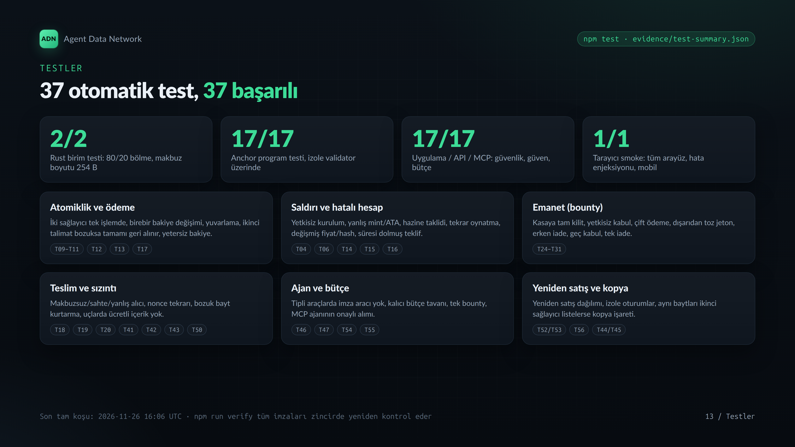

# 08 · Kanıtlar ve testler

> Kural: hiçbir imza, makbuz ya da test sonucu uydurulmadı. Aşağıdaki her imza Solana Explorer'da (Devnet) açılabilir. Tam liste: [tablolar/devnet-islemleri.csv](tablolar/devnet-islemleri.csv), [tablolar/devnet-makbuzlari.csv](tablolar/devnet-makbuzlari.csv).

## Devnet deploy

| Alan | Değer |
|---|---|
| Program ID | `3vZNsmhko4nWqmFbAehmdwRmKLMyusqEPZCLP4rLQEA8` |
| Sahip | `BPFLoaderUpgradeab1e11111111111111111111111` (yükseltilebilir loader) |
| ProgramData | `FQY21Vtkzy2LNntNoKBTYZrtdwrPiwmNpmoFEmAcPaw1` |
| Authority | `Cu7ctAUxW25GsGGPVvNupujU81A9jvEZUGjo2sUdgVZ7` |
| Deploy slotu | 526297989 |
| Deploy imzası | `2GXRCR1iGKVXnb75RZwRDmW8mK7PBbKgD4CVFMPMoWnqWLv3CV15eoJXumDLz6h5whT3jBLuyKVhKyjsuwgs2QRm` |
| Veri uzunluğu | 370 960 bayt |
| Kira | 1.88535564 SOL |
| `adn.so` sha256 | `94bb22a4e4fac3db56084e884262355f1390aba1f16158c45294b1d975bbe687` |
| Yüklenen baytlar = yerel derleme | **Evet** (`deployedBytesMatch: true`) |
| IDL sha256 | `2989786a6e0ff0286b07b1aaa32157d5788b6a89495ee0d93d39ecdf76368b88` |
| aUSD mint | `DKFLsvxjFa2KJetFquiUH3cr4hp5QRuuiGVGBPjwPMDN` |
| Hazine | `k3fiTTbTdJV5CT8cJHw6KBFzsFyoUWpxSePtBsD8Qj7` |
| NorthLab cüzdanı | `B3MfpnQkA1wPddYu5DkzewmSnEetwy8zfWiPNhVkWvAm` |
| SouthSupply cüzdanı | `GpB87pmju8jM3haqYUeEH1kYLMGVAoDz9B66tXARsCpD` |

Kaynak: `evidence/devnet-deploy.json`, `devnet-program-show.txt`, `devnet-deploy-output.txt`.

## Son tam Devnet oturumu: `run-20261126160622-324f29`

Canlı kopya (Vercel) bu oturumu gösteriyor. 13 işlem, 4 makbuz.

| Adım | Ne | İmza (kısaltılmış) | Slot |
|---|---|---|---|
| READY | Ajana 2.1 aUSD fonlama | `4M9fPqqC…kcRZ` | — |
| READY | İkinci ajana 0.1 aUSD | `3354BxUS…QST` | — |
| READY | İade talep sahibine 2 aUSD | `F17aV47B…KNq` | — |
| READY | Önceki oturumun sipariş listelemesini geri çekme | `uYbkK495…8JN` | 526563117 |
| PAYMENT_PENDING | **Atomik iki sağlayıcılı satın alma** | `5oEj3wfizEPwPiyxswq7zHBwCLzxHNr1QvqyNd3BxNZfSTSDHGbawnmvp7UKmoy4CAE7sFsyu9J1oFnRvHfnMRsW` | 526563154 |
| GAP | **Ödül oluşturma** (2 aUSD → kasa) | `3FtymqJ17KZWzsuSNWBgDC2KTgCcvJqv3bufA8fUytXcHNzTzrbankLDWJkqJPsJiN1w4PfviU1jejcTovHeVrYk` | 526563209 |
| BOUNTY_FUNDED | Aday 1 gönderimi | `2AkVDDrF…MkJ` | 526563250 |
| BOUNTY_FUNDED | Aday 2 gönderimi | `58KEMYWi…MWG` | 526563251 |
| REVIEWED | **Ödül kabulü** (80/20) | `2NGCd5nZTRkJk6BUXgcYVuCAtoxowe4d3f4fd2Ght5vS2azJZr1ojtUo9jPRLWPZMq1Lx13rsQvJDK8GcwfkXb61` | 526563296 |
| DELIVERED | Sipariş birimini satışa açma | `3t4owANv…PvSH` | 526563328 |
| ACTIVATED | **Yeniden satış** | `5FPkLAZJvSFyVyD7NQGzuWnKHhfiQYzXguoT3A6rs3SLgXHLnbbPM1yLBV5iGKXEuekySy9NB3pBPGFgjAvtTNGN` | 526563352 |
| RESOLD | Kısa ödülün fonlanması | `4wUsyMjU…yHEE` | 526563390 |
| RESOLD | **Tam iade** (komisyonsuz) | `nZYdksco2ZUivUFQsa5eg3ew7J8ZTUTdBPVWKwBhdKSL43VMHbtvRYQw2TgYnDzdtQKH3BAzgT6rLnwtutxKGQH` | 526563470 |

Her ekonomik işlemin ücreti 5 000 lamport.

### Bakiye değişimleri (baz birim, 1 aUSD = 1 000 000)

| Olay | Ajan | İkinci ajan | İade sahibi | NorthLab | SouthSupply | Hazine | Kasa |
|---|---|---|---|---|---|---|---|
| Satın alma | −60 000 | 0 | 0 | +24 000 | +24 000 | +12 000 | |
| Ödül fonlama | −2 000 000 | 0 | 0 | 0 | 0 | 0 | +2 000 000 |
| Ödül kabulü | 0 | 0 | 0 | +1 600 000 | 0 | +400 000 | −2 000 000 |
| Yeniden satış | 0 | −30 000 | 0 | +24 000 | 0 | +6 000 | |
| İade fonlama | 0 | 0 | −2 000 000 | 0 | 0 | 0 | +2 000 000 |
| İade | 0 | 0 | +2 000 000 | 0 | 0 | 0 | −2 000 000 |

### Makbuzlar

| PDA | Tür | Sağlayıcı | Tutar | 80 / 20 |
|---|---|---|---|---|
| `2AxrTtdCha8tgo7VwjjGh4XPubJXDrRmPRRydFLXMhr4` | satın alma (X100 datasheet) | NorthLab | 30 000 | 24 000 / 6 000 |
| `DHKhKcb4qHH8BmaEAxXZHtgnnbsmsGqWRJLqFmmzwoYr` | satın alma (X100 stok/teslim) | SouthSupply | 30 000 | 24 000 / 6 000 |
| `6asEahJBuAnwXBGm2eUYPREtbr6rFKAPvDF3zY2HDwAQ` | ödül (geri dönüşüm sertifikası) | NorthLab | 2 000 000 | 1 600 000 / 400 000 |
| `E4NeK6VLczBNrS7FUZVyEpQorKomyLZkgtW7XxW9M1m7` | yeniden satış (ikinci ajan) | NorthLab | 30 000 | 24 000 / 6 000 |

Ödül PDA'sı `C6fHzFki3qtPtbKbWiEbw25jE1XRUiMt93c6uXc9eUS1`, kasa `2c4t7kwip1BtrBX4194khLGb2cnM7VZCweKV57GzRP47`. Tam adresler CSV'de.

## İlk tam Devnet oturumu: `run-20261125222532-6b1667`

Aynı akışın ilk Devnet koşusu (o zaman para birimi "TEST" etiketliydi): atomik satın alma `5mMZitFv…S1dJn`, ödül kabulü `2JX1Ew6C…qcv`, yeniden satış `4iNcJoBr…hYiEV`, iade `59dRrDWv…eVyBG`. Kazanç: NorthLab 1.648, SouthSupply 0.024, hazine 0.418. Ayrıntı: `PROJECT-STATE.md`.

## Tüm oturumlar

`evidence/runs/` altında 19 oturum kaydı var: 5 Devnet (4 tamamlandı, 1 hata: mint uyuşmazlığı, düzeltildi ve sonraki koşu başarılı) ve 14 yerel (hepsi tamamlandı). Son tam yerel oturum `evidence/run-manifest.json`, son Devnet oturumu `evidence/devnet-run-manifest.json`.

Her manifest şunları içerir: imzalar, slotlar, ücretler, çözülmüş makbuzlar, bakiye değişimleri, hash kontrolleri, inceleme raporları, bütçeler, kapılar (gates) ve sınırlamalar.

## Kendin nasıl doğrularsın?

1. **Explorer'da:** program adresini ya da yukarıdaki herhangi bir imzayı `?cluster=devnet` ile aç.
2. **Komutla:** `npm run verify:devnet` (Devnet) ya da `npm run verify` (yerel). `getTransaction` + çözülmüş makbuz hesaplarıyla her şeyi yeniden kontrol eder.
3. **Arayüzde:** Control → Verify receipt alanına bir makbuz PDA'sı yapıştır.
4. **MCP ile:** `verify_receipt` aracı.

Yerel imzalar yalnızca yerel ledger'da vardır, Explorer bağlantısı olmaz; yerel validator tam geçmiş tuttuğu için `npm run verify` ile doğrulanır.

## Testler

| Paket | Sonuç | Nerede |
|---|---|---|
| Rust birim (bölme matematiği, makbuz boyutu) | 2/2 | `programs/adn/src/lib.rs` |
| Anchor programı (izole yerel validator) | 17/17 | `tests/anchor/adn.test.ts` |
| Uygulama / API / MCP | 17/17 | `tests/app/api.test.ts`, `tests/app/mcp.test.ts` |
| Tarayıcı smoke | 1/1 | `scripts/ui-smoke.ts` |
| **Toplam** | **37/37** | `evidence/test-summary.json` (2026-11-26 16:06 UTC) |

Tam test listesi ve ne kontrol ettikleri: [tablolar/testler.csv](tablolar/testler.csv).

### Tarayıcı smoke testi ne yapar?
- Tüm arayüzü gerçek bir oturumla adım adım ve otomatik sürer.
- Satın alınmadan önce ücretli içeriğin görünmediğini kontrol eder.
- Gerçek bir hata enjekte eder (bir listelemeyi bozar), hatanın görünür olduğunu, para kesilmediğini ve tekrar denemenin başarılı olduğunu kontrol eder.
- Pazar ve bounty sayfalarında ücretli içerik / cevap olmadığını kontrol eder.
- Telefon genişliğinde yatay taşma olmadığını kontrol eder.
- Konsol hatası olmadığını kontrol eder.
- Ekran görüntülerini `evidence/screenshots/` altına kaydeder.

## Doğrulama sırasında bulunup düzeltilen hatalar

| Sorun | Düzeltme |
|---|---|
| Kanıt dosyaları ve `/api/v1/evidence` ücretli içeriği gösteriyordu | Yalnızca hash tutuluyor; sızıntı taraması eklendi |
| İade demosu ~13 sn geride bir saatten son süre hesaplıyordu ("erken" iade aslında geçti) | Zincir saati kullanılıyor |
| Yerel validator eski işlem geçmişini siliyordu | Tam geçmiş (`--limit-ledger-size`) |
| İade bakiye değişimi ödül fonlanmadan önceki değerden ölçülüyordu (0 görünüyordu) | Fonlama ve iade değişimleri ayrıldı |
| Satın alma uzlaştırması imza geçmişine bağlıydı | Önce makbuz hesapları kontrol ediliyor |
| Test validator portları ana validator ile çakışıyordu | İzole portlar |
| İlk Devnet deploy `--use-rpc` ile 40 dk takıldı | Buffer kapatıldı, 1.885 SOL geri alındı, TPU ile tekrar yüklendi |
| Yarıda kalan kurulum ikinci bir mint açıyordu | Zincirdeki config'teki mint kullanılıyor |
| Devnet'te 24 paralel kayıtta "Blockhash not found" | Eşzamanlılık 4 + `sendWithRetry` |
| MCP alımında "AccountNotFound" (fonlama yalnızca confirmed'di, simülasyon finalized'da) | Fonlama kesinleşene kadar bekleniyor |
| Arayüzde "Running" durumu 1.2 sn geç görünüyordu | Adım başlarken hemen yeniden çizim |
| Harcama hakkı bitince ajan genel bir hata alıyordu | "request_budget çağır" mesajı |
| Test cüzdanları ajan listesine düşüyordu; liste son aktife göre sıralanmıyordu | Düzeltildi |
