# 09 · Arayüz rehberi (sayfa sayfa)

Arayüz `src/web/` altında, derleme adımı olmayan vanilla JS. Koyu, sade, kripto borsası havasında bir tasarım. Her sayı gerçek oturum durumundan gelir; uydurma ya da simüle veri gösterilmez. Aşağıdaki görüntüler canlı kopyadan (gerçek Devnet oturumu) alındı.

## Üst şerit (her sayfada)

- **Marka:** "Agent Data Network · Licensed data for AI agents, settled on Solana".
- **Durum çipleri:** ağ (Solana Devnet / Localnet), program, mint, RPC durumu, oturum kimliği. Canlı kopyada ayrıca "PUBLIC COPY · read-only".
- **Akış adımları:** Discover · Purchase · Verify · Commission · Reuse (o anki aşama vurgulu).
- **Düğmeler:** Run agent task / Continue task / Task complete · Pause · Next step · New session · **? Tour**.

## Overview

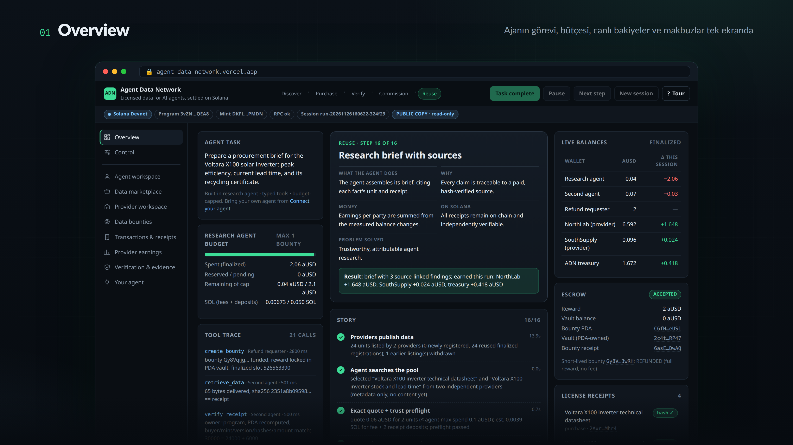

Ajanın görevi, araştırma ajanı bütçesi (harcanan, rezerve, kalan, SOL), araç izi (tool trace), 16 adımlık hikâye, canlı bakiyeler (her cüzdanın bakiyesi ve bu oturumdaki değişimi), kasa durumu ve lisans makbuzları. Sonuç kutusu: kaç kaynaklı bulgu, kim ne kazandı.

## Control

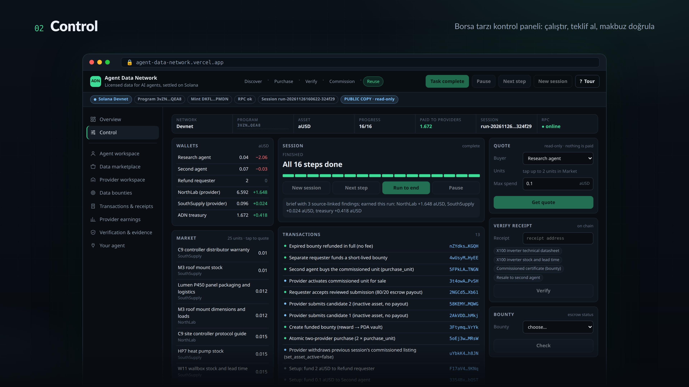

Borsa terminali gibi sade bir yönetim ekranı:
- üstte ağ, ilerleme, ödenen tutar ve RPC durumu şeridi;
- solda cüzdanlar ve market listesi;
- ortada 16 kutucukla ilerleme ve New session / Next step / Run to end / Pause, altında işlem akışı;
- sağda üç araç: **Quote** (2 birim seç, fiyat al, ödeme yok), **Verify receipt** (makbuzu zincirden doğrula), **Bounty** (kasa durumu).

## Agent workspace

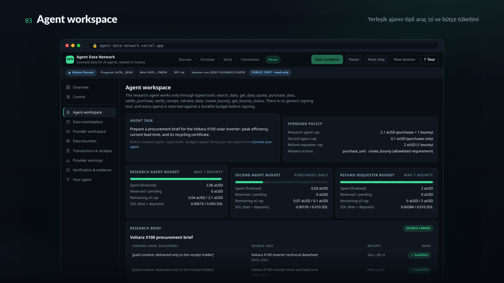

Görev metni, harcama politikası (ajan 2.1 aUSD + 1 bounty, ikinci ajan 0.1 aUSD yalnızca alım, izin verilen eylemler), üç bütçe kartı ve araştırma brifingi (her bulgu, kaynak birim ve makbuz ile).

## Data marketplace

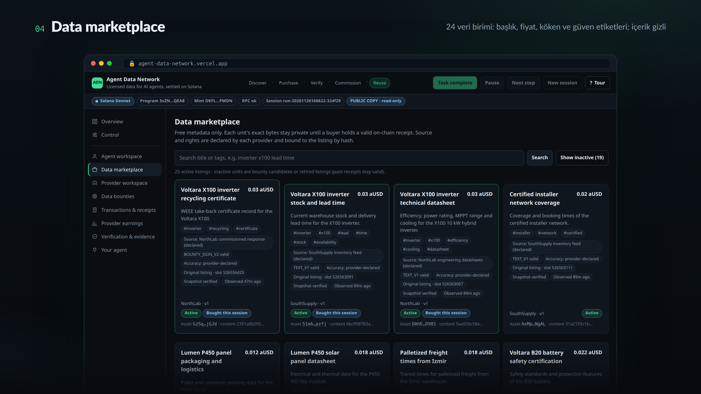

24 aktif birim (+ sipariş edilen sertifika). Arama kutusu, "Show inactive". Her kartta: başlık, fiyat, özet, etiketler, kaynak, şema, "Accuracy: provider-declared", "Original listing · slot …" ya da "Copy of an earlier listing · not for sale", snapshot durumu, gözlem zamanı. İçerik asla gösterilmez.

## Provider workspace

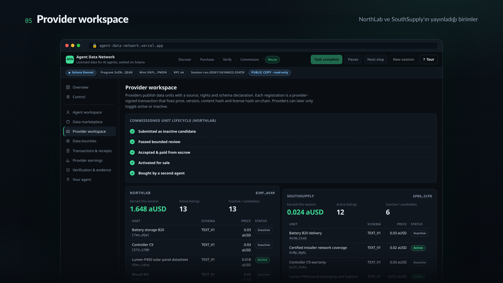

Sipariş edilen birimin yaşam döngüsü (pasif aday → incelemeden geçti → kabul ve ödendi → satışa açıldı → ikinci ajan satın aldı), NorthLab ve SouthSupply'ın kazançları ve birim tabloları (şema, fiyat, durum).

## Data bounties

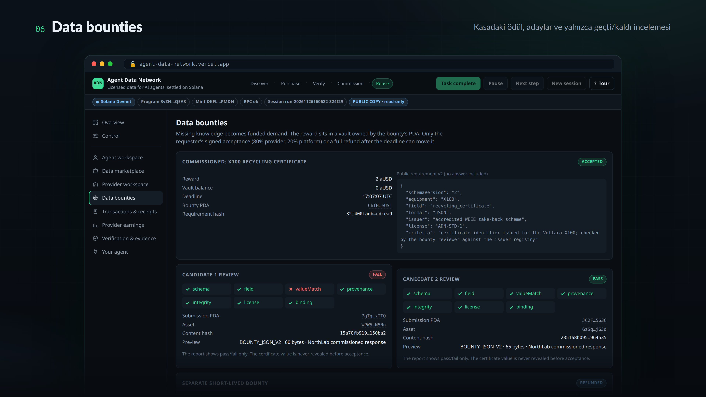

Ödül kartı (ödül, kasa bakiyesi, son süre, bounty PDA, gereksinim hash'i), herkese açık gereksinim JSON'u (cevap yok), iki adayın inceleme raporları: şema, alan, valueMatch, köken, bütünlük, lisans, bağlama kontrolleri. Aday 1 **FAIL** (valueMatch), aday 2 **PASS**. Ayrıca kısa ömürlü iade ödülü.

## Transactions & receipts

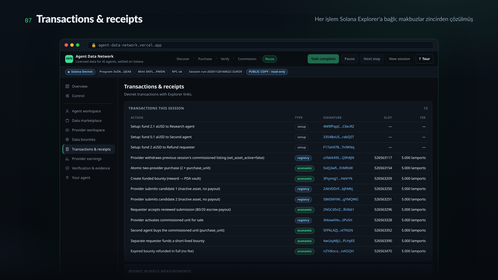

Oturumdaki her işlem: açıklama, tür (setup / registry / economic), imza (Explorer bağlantılı), slot, ücret. Altında atomik paket ölçümleri ve çözülmüş makbuzlar.

## Provider earnings

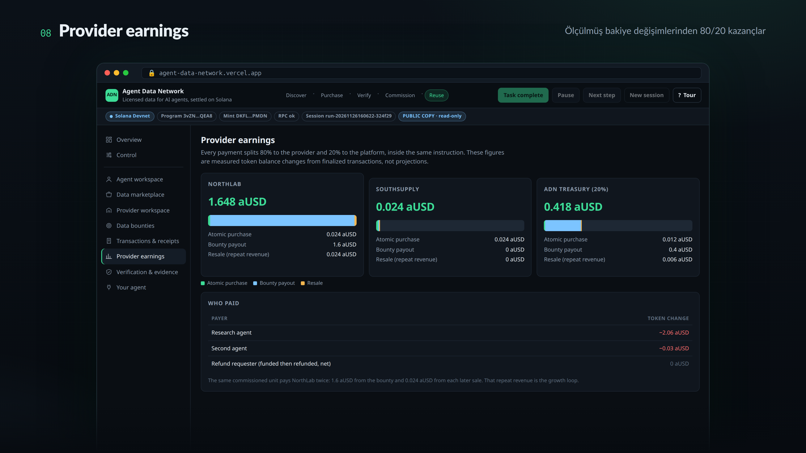

Her taraf için atomik satış / ödül / yeniden satış ayrımıyla kazanç çubukları ve "Who paid" tablosu. Rakamlar kesinleşmiş işlemlerin ölçülmüş token değişimlerinden.

## Verification & evidence

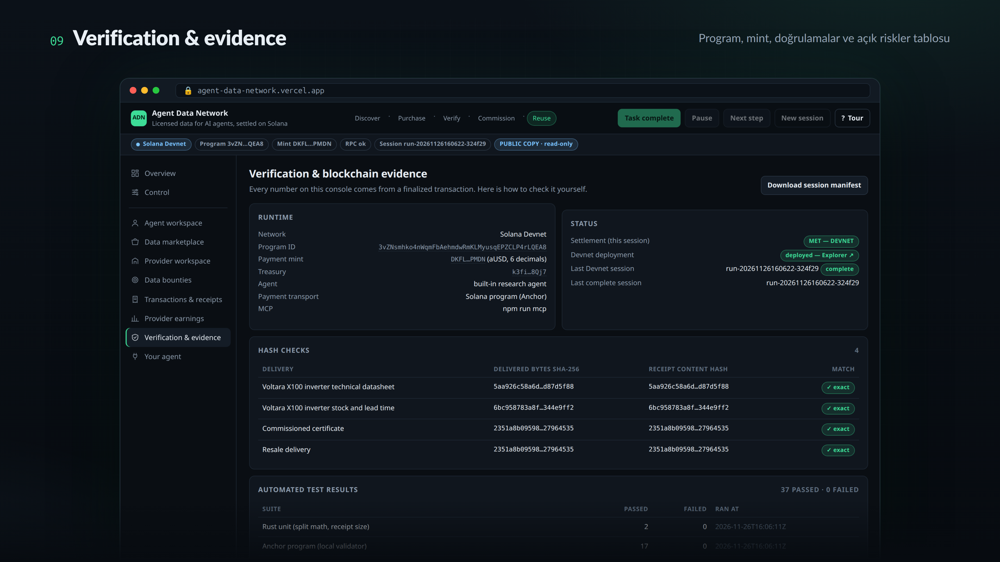

Çalışma ortamı (ağ, program, mint, hazine, ajan, ödeme taşıması, MCP), durum (Devnet deploy, son Devnet oturumu), hash kontrolleri (teslim edilen baytların sha256'sı = makbuzdaki içerik hash'i), otomatik test sonuçları, "Download session manifest" ve **Open risks** tablosu.

## Your agent

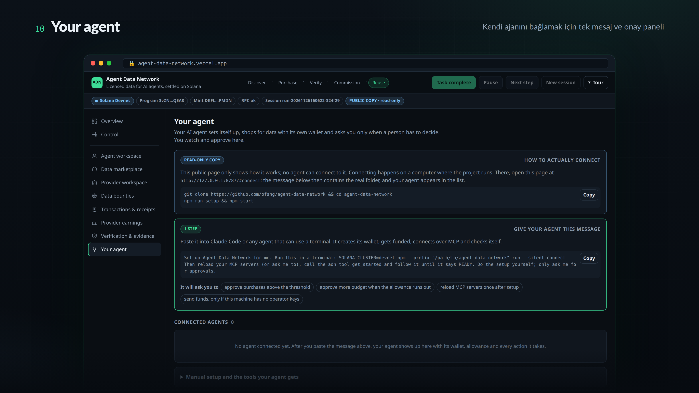

Kendi ajanını bağlama sayfası: "Give your agent this message" kutusu ve **Copy**, ajanın soracağı şeyler, bağlı ajanlar (cüzdan, hak çubuğu, eşik, bekleyen onaylar ve Approve/Decline, canlı aktivite), katlanmış "Manual setup". Canlı kopyada bu bir vitrindir: bağlantı ancak projenin kurulu olduğu bilgisayarda yapılır.

## Rehberli tur

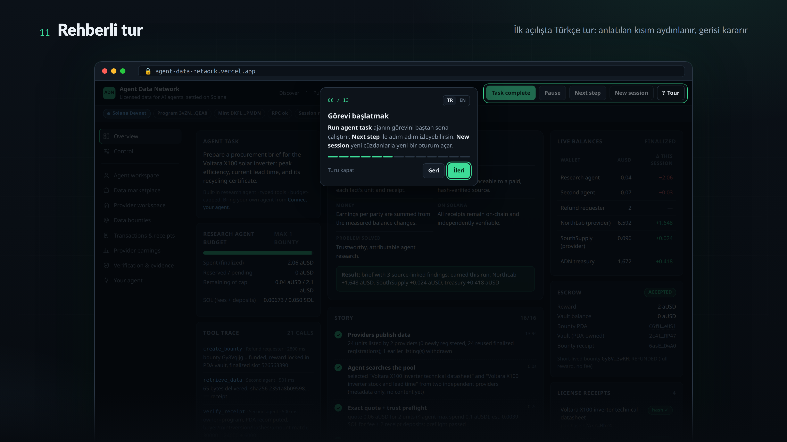

İlk ziyarette kendiliğinden açılır, sonra **? Tour** ile. 13 adım. Anlatılan kısım yeşil çerçeveyle aydınlanır, gerisi kararır. TR/EN geçişi, klavye (← → Esc), telefonda kart ekranın altına yerleşir. Tarayıcı Türkçeyse Türkçe açılır.

Turun anlattıkları: uygulama ne işe yarar; ağ ve para birimi (aUSD, Solana); pazar yeri ve satıcılar (üretici ve distribütör); ajan (Voltara X100 görevi, harcama sınırı); görevi başlatmak; tek işlemde iki satıcıya ödeme ve makbuz; eksik veri için ödül ve kasa; 80/20 kazanç; Kontrol paneli; Kanıt sayfası ve açık riskler; kendi ajanını bağlamak; son olarak Kontrol panelinden "Run agent task" ile başlamak.

## Telefonda

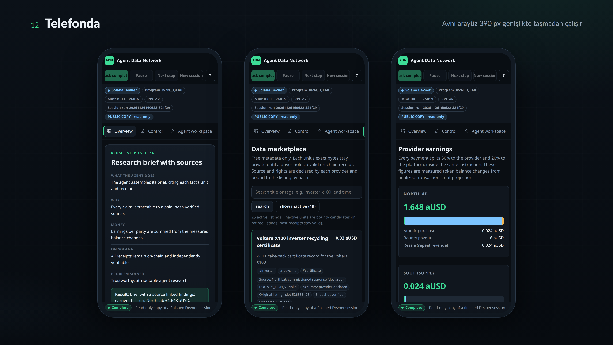

390 px genişlikte yatay taşma yok (tarayıcı testi kontrol ediyor).
