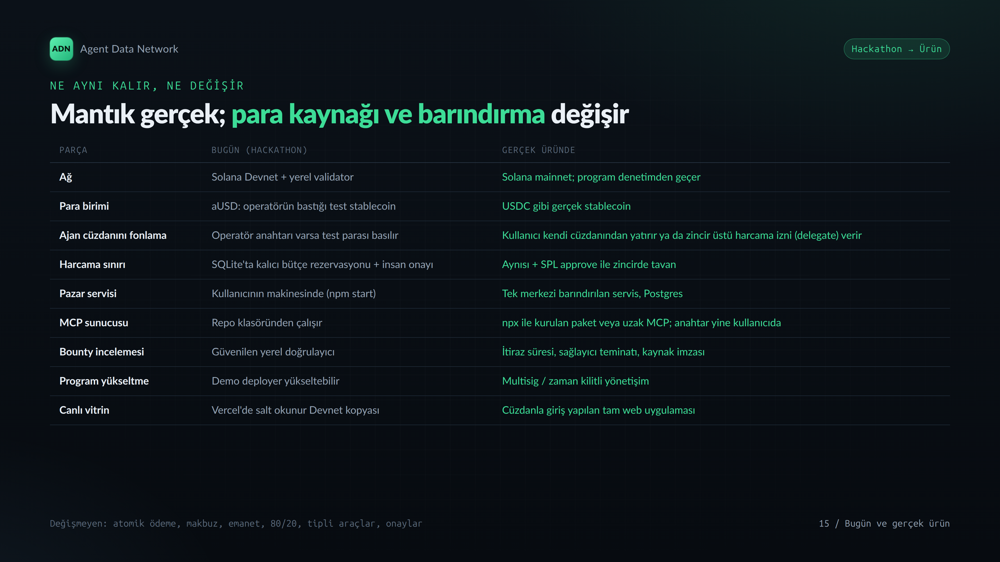

# 11 · Yol haritası: hackathon'dan ürüne

Bu sayfadakiler **plan**dır; hiçbiri bugün yapılmış değildir (yapılmış olanlar açıkça belirtildi).

## Değişmeyen çekirdek
Atomik çoklu sağlayıcı ödemesi, değiştirilemez makbuz, programın uyguladığı ödül emaneti, 80/20 bölüşüm, tipli araçlar (imza aracı yok), insan onayları, hash doğrulamalı teslim, snapshot kurtarma.

## Aşama 1: Ürünleşme (altyapı)
| İş | Neden |
|---|---|
| Pazar servisini kalıcı bir sunucuya taşımak (Railway / Fly.io / VPS), SQLite → Postgres | Herkes tek bir pazara bağlansın; Vercel sürekli çalışan süreç ve veritabanı için uygun değil |
| MCP sunucusunu npm paketi yapmak: `claude mcp add adn -- npx agent-data-network-mcp` | Repo indirmeden tek satır kurulum |
| Uzak (hosted) MCP seçeneği | Hiçbir şey kurmadan bağlanma; imza yine kullanıcı tarafında |
| aUSD yerine USDC | Herkes kendi parasıyla; operatörün para göndermesi gerekmez |
| Kullanıcı fonlaması: kendi cüzdanından yatırma ya da SPL `approve` ile zincir üstü harcama izni | Sınırı Solana korur |
| İsteğe bağlı yönetilen cüzdan (Privy, Turnkey) | Teknik olmayan kullanıcılar için |
| Web uygulamasında cüzdanla giriş | Gerçek kullanıcı hesabı |

## Aşama 2: Güven
| İş | Hangi riski kapatır |
|---|---|
| Alıcıya özel filigran (watermark) | Kopyalayıp satma: sızıntı hangi makbuzdan çıktı |
| Listelemede benzerlik kontrolü | Küçük değişiklikli kopya |
| Ödeme öncesi itiraz süresi (ör. 48 saat kasada bekleme) | Ödüle sahte veri |
| Sağlayıcı teminatı (stake), kanıtlanmış sahtede kayıp | Sahte veriyi kârsız kılmak |
| Kaynak imzası (üretici/kurum anahtarıyla imzalı cevap, zincirde kontrol) | Doğruluk ve köken |
| zkTLS ("bu veri şu siteden alındı" kanıtı) | Kaynak kanıtı |
| İtibar (itiraz geçmişi, tekrar satış başarısı) | Yanlış katalog verisi |
| Birden fazla bağımsız kaynağın örtüşmesi | Doğruluk güveni |
| Lisansta "yeniden satılamaz" şartı + takip | Hukuki koruma |

## Aşama 3: Program ve yönetişim
| İş | Neden |
|---|---|
| Güvenlik denetimi | Mainnet öncesi şart |
| Upgrade authority → multisig / zaman kilidi | Tek anahtar riski |
| Makbuz maliyeti: sıkıştırılmış (compressed) / Merkle makbuzlar | Küçük alımlarda kira depoziti yükü |
| Üç ve daha fazla birimlik paketler, gerekirse v0 işlem + adres arama tablosu (ALT) | 1232 bayt sınırı (bugün 2 birim = 784 bayt) |
| Ödülde kısmi ödeme, erken iptal, hakemlik | Bugün kapsam dışı |

## Aşama 4: Pazara giriş
- **Tek dikey:** ekipman tedarik verisi (teknik özellik, stok, teslim süresi, sertifika).
- İlk ödülleri platformun kendisi fonlaması (tohum talebi).
- Sağlayıcıya "araç" olarak değer: kendi müşterilerine lisanslı veri satışı, makbuz ve otomatik ödeme.
- Alıcı tarafında MCP kayıt defterleri ve ajan geliştirici toplulukları.
- Etkinlik sonrası çevrimiçi pilot; gerçek talep, birim ekonomisi ve hukuki inceleme olmadan ticari başlangıç yok.

## x402 ile ilişki
x402'nin standart "exact SVM" kolaylaştırıcısı bugün özel Anchor talimatlarını kabul etmiyor. İleride kolaylaştırıcılar özel programları destekler ya da bir akıllı cüzdan izin listesine girersek x402, ödeme taşıması olarak eklenebilir. O zamana kadar doğrudan alıcı imzalı Anchor işlemi kullanılıyor.
