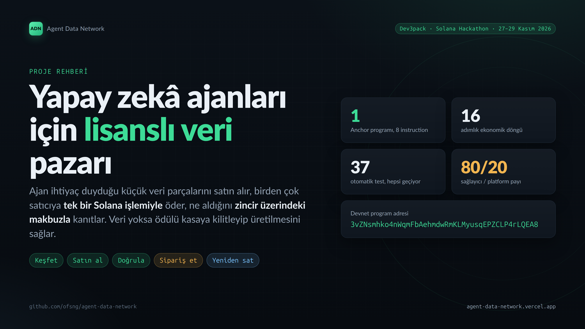

# Agent Data Network · Proje Rehberi



Bu klasör projeyle ilgili her şeyi tek yerde toplar: ne olduğu, nasıl çalıştığı, teknik ayrıntılar, kanıtlar, iş modeli, yarışma bilgileri ve jürinin sorabileceği **300 soruya cevap**. Bütün bilgiler kodla, `evidence/` klasöründeki gerçek Devnet kayıtlarıyla ve proje sohbetleriyle karşılaştırıldı.

## Nereden başlamalı?

| Amacın | Oku |
|---|---|
| 5 dakikada anlamak | [01-proje-ozeti.md](01-proje-ozeti.md) + [video](video/adn-proje-anlatimi-tr.mp4) |
| Akışı adım adım görmek | [02-nasil-calisir.md](02-nasil-calisir.md) |
| Jüriye hazırlanmak | [SSS/](SSS/README.md), özellikle [08-zor-sorular](SSS/08-zor-sorular.md) ve [09-ingilizce-kisa-cevaplar](SSS/09-ingilizce-kisa-cevaplar.md) |
| Teslim formunu doldurmak | [10-yarisma-ve-teslim.md](10-yarisma-ve-teslim.md) |

## Belgeler

| Dosya | İçerik |
|---|---|
| [01-proje-ozeti.md](01-proje-ozeti.md) | Tek cümle, temel bilgiler, problem, çözüm, neden Solana, kimin için, Türkçe/İngilizce kısa sunum |
| [02-nasil-calisir.md](02-nasil-calisir.md) | Benzetme, roller, 16 adım, atomik satın alma, ödül, teslimat, para akışı, kontroller |
| [03-teknik-mimari.md](03-teknik-mimari.md) | Katmanlar, dosyalar, API uçları, tablolar, anahtarlar, sürümler, komutlar, tasarım kararları |
| [04-solana-programi.md](04-solana-programi.md) | 8 instruction, PDA'lar, bölüşüm formülü, 19 hata, ölçümler, deploy maliyeti |
| [05-guvenlik-ve-guven.md](05-guvenlik-ve-guven.md) | Zincir üstü ve zincir dışı korumalar, güven varsayımları, güven katmanları, açık riskler |
| [06-ajan-ve-mcp.md](06-ajan-ve-mcp.md) | İki tür ajan, MCP, kurulum, 14 araç, onaylar, harcama hakları, "gerçekte nasıl olacak" |
| [07-is-modeli-ve-pazar.md](07-is-modeli-ve-pazar.md) | Gelir, birim ekonomisi, marketplace eleştirisi, tavuk-yumurta, müşteri profili, rekabet |
| [08-kanitlar-ve-testler.md](08-kanitlar-ve-testler.md) | Devnet deploy, gerçek imzalar, bakiye değişimleri, makbuzlar, 37 test, düzeltilen hatalar |
| [09-arayuz-rehberi.md](09-arayuz-rehberi.md) | 10 sayfa ve rehberli tur, ekran görüntüleriyle |
| [10-yarisma-ve-teslim.md](10-yarisma-ve-teslim.md) | Dev3pack kuralları, form bilgileri, video planı, açıklamalar, kontrol listesi |
| [11-yol-haritasi.md](11-yol-haritasi.md) | Hackathon'dan ürüne dört aşama |
| [12-proje-gecmisi.md](12-proje-gecmisi.md) | Zaman çizelgesi, commit'ler, kararlar, dürüstlük kuralları |
| [13-sozluk.md](13-sozluk.md) | 60'a yakın terimin basit anlamı |
| [SSS/](SSS/README.md) | 9 dosyada 300 soru-cevap |

## Görseller (hepsi 3840×2160, 4K)

**Diyagramlar** (`gorseller/diyagram/`): HTML/CSS ile tasarlanıp çizildi; kaynakları `kaynak/diyagram/`.

| | | |
|---|---|---|
| 01 Kapak | 02 Problem ve çözüm | 03 Ekonomik döngü |
| 04 Atomik satın alma | 05 Ödül yaşam döngüsü | 06 Mimari |
| 07 Hesaplar (PDA) | 08 Makbuz ne kanıtlar | 09 Teslimat ve kurtarma |
| 10 Ajan bağlantısı | 11 16 adım | 12 Devnet para akışı |
| 13 Testler | 14 Rekabet | 15 Bugün ve gerçek ürün |
| 16 Riskler | 17 Güven katmanları | |

**Ekran görüntüleri** (`gorseller/ekran/`): canlı kopyadan, gerçek Devnet oturumuyla, tarayıcı çerçevesi içinde. Overview, Control, Agent workspace, Data marketplace, Provider workspace, Data bounties, Transactions, Earnings, Evidence, Your agent, rehberli tur, telefon görünümü.

## Video

| Dosya | Açıklama |
|---|---|
| [video/adn-proje-anlatimi-tr.mp4](video/adn-proje-anlatimi-tr.mp4) | 7 dk 17 sn, 1920×1080, Türkçe kadın sesi (Microsoft Emel), gömülü Türkçe altyazı. 17 diyagram + 6 ekran görüntüsü, yavaş yakınlaşmayla. **Anlamak içindir; 3 dakikayı aştığı için yarışma videosu değildir.** |
| [video/adn-proje-anlatimi-tr.srt](video/adn-proje-anlatimi-tr.srt) | Ayrı altyazı dosyası |

Anlatım metni: [kaynak/video-anlatim.json](kaynak/video-anlatim.json). Yarışma videosu için plan: [10-yarisma-ve-teslim.md](10-yarisma-ve-teslim.md) ve repo kökündeki `DEMO-SCRIPT.md`.

## Tablolar (`tablolar/`, CSV; Excel/Sheets ile açılır)

| Dosya | İçerik |
|---|---|
| [veri-katalogu.csv](tablolar/veri-katalogu.csv) | 24 birim: sağlayıcı, başlık, etiketler, özet, fiyat, 80/20 paylar, lisans (ücretli içerik hariç) |
| [devnet-islemleri.csv](tablolar/devnet-islemleri.csv) | Son Devnet oturumunun 13 işlemi, tam imzalar ve Explorer linkleri |
| [devnet-makbuzlari.csv](tablolar/devnet-makbuzlari.csv) | 4 makbuz, tüm alanlarıyla |
| [testler.csv](tablolar/testler.csv) | 37 testin her biri ne kontrol ediyor |
| [komutlar.csv](tablolar/komutlar.csv) | Bütün komutlar ve ne zaman kullanılır |

## Yeniden üretmek

Repo kökünden:

```bash
npx tsx PROJE-REHBERI/kaynak/render.ts
```
```bash
npx tsx PROJE-REHBERI/kaynak/ekran.ts
```
```bash
python3 PROJE-REHBERI/kaynak/video.py <edge-tts yolu> <geçici klasör>
```

## Kaynaklar

Bu rehber şunlardan derlendi: kaynak kod (`programs/`, `src/`, `tests/`, `scripts/`), `README.md`, `SUBMISSION.md`, `PROJECT-STATE.md`, `DEMO-SCRIPT.md`, `evidence/` (deploy, Devnet manifest'leri, testler, kurallar, araç zinciri), `STARTUP-PACKAGE/` (iş planı, model, pazar, kararlar) ve bu projedeki üç Claude Code sohbeti (V1.3 → V1.5 geliştirme, final release, jüri soruları ve "gerçek ürün" değişiklikleri).

**Dürüstlük notu:** aUSD bir test stablecoin'idir, katalog örnek veridir, yerleşik ajan kurallara dayalıdır. Mainnet, gerçek para, müşteri ya da gelir yoktur.
