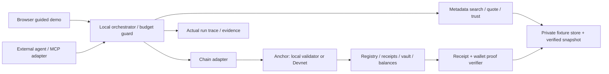

# Architecture — V1.5 local-first demo
One existing Anchor workspace + one existing web app (prefer Next.js Node, reuse working stack) + SQLite or an already-working equivalent local store + local demo driver. No cloud accounts, separate services, queue, vector DB, user signup, production auth/hosting or mainnet. Browser and orchestration server bind to loopback. Separate synthetic sandbox from existing state. Anchor remains financial authority in actual chain modes; SQLite indexes exact bytes and run state, never overrides chain result.

## Implementation boundaries
- `programs/adn`: unchanged V1.4 ABI; local validator tests. `src/chain`: IDL, PDA derivation, tx construction, actual RPC, decode, mode. `src/data`: fixture import, immutable bytes, trust, search, local backup. `src/agent`: deterministic step driver, typed tool facade, bounded budget. `src/demo`: scenario/run state, reset, event log, mode-specific evidence. `app/`: UI and loopback API. Reuse equivalent existing paths.
- Modes: `LOCAL_CHAIN` default (actual local validator + Anchor); `DEVNET` optional (actual RPC + same program); `SIMULATION` isolated deterministic state machine for UI fallback only. Mode fixed at run creation. Never invent signatures, fake RPC, Explorer links or claim simulated transfers as actual. Simulation tests prove simulation only, not contract. Label every screen and artifact with mode; require explicit simulation selection or clearly announce fallback before run.
- Store original fixture bytes, hashes, metadata and separate verified snapshot. Keep sidecar migration 004 if SQLite exists. Simpler demo persistence allowed (single-process SQLite or atomic file journal) if equivalent evidence, recovery and idempotency tests pass; no rewrite of a working DB. No full disaster-recovery architecture. Existing paid data retained; only reset isolated new demo sandbox.
- Demo commands: `demo:setup`, `demo:start`, `demo:test`, `demo:reset` (adapt to actual package manager, document exact commands). Setup checks pinned dependencies, builds program, starts/reuses isolated local validator, creates test mint/ATAs, seeds known fixture assets. Start launches app + run driver; reset uses new run IDs/wallets/bounties or dedicated disposable validator ledger, never historical Devnet or repository state. Devnet optional explicit mode, no repeated faucet polling.
- Browser action allowlist: start, advance/auto-run, reset, inspect, negative-test toggles. No generic sign or private key endpoint. Local demo endpoints accept only preconfigured fixture actions, enforce loopback/CSRF or local CLI bridge and run token; operator starts a run with explicit cap. Never expose browser to public internet. Keys restricted and ignored by git; not in client bundle or evidence.
- Every purchase, bounty and refund uses fresh run-specific IDs, actual finality (local finalized or equivalent documented actual commitment), exact integer amounts; pending persists and reconciles without duplicate charge. Payment atomically moves tokens + receipts, not off-chain data. Delivery validates receipt and buyer challenge, hash, then releases bytes; prepay and preaccept show metadata only. Snapshot restores exact bytes. No production promises.
- Real external agent via local MCP if available; deterministic controller uses same tools and produces evidence, not model reasoning. x402 adapter capability preview may show quote/HTTP 402 but no claim of compliant facilitator or settlement unless separately tested. No production secrets, external dependency required for core demo.
