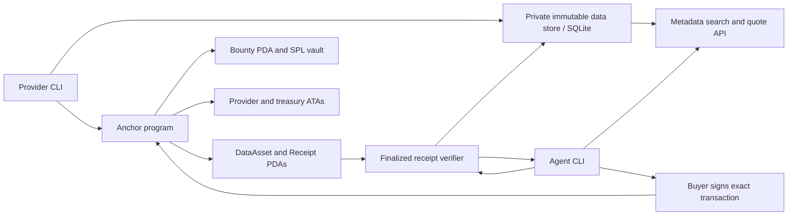

# Architecture
One Anchor workspace + one Node/Next.js app + SQLite + local demo CLI. Program state is the financial authority; SQL is content cache/index, never source of paid status. No facilitator or platform custody required for P0. Devnet and local validator configs separate. No production credentials.

## Components and setup
`programs/adn/` instructions/accounts/errors; `tests/anchor/` local validator; `app/` pages and Node API routes; `src/chain/` PDA derivation, IDL, exact tx builder, finalized decoder, RPC retry; `src/data/` CSV importer, hashing, SQLite migrations, metadata ranking; `src/auth/` wallet challenge/nonce verification; `scripts/` bootstrap mint/ATAs, seed, demo CLI, verify, expire/refund; `tests/` integration/E2E; `evidence/` sanitized artifacts; `PROJECT-STATE.md`. Use lockfiles. Keep demo keys outside repo with chmod 600, separate buyer/providerA/providerB/treasury/admin, disposable Devnet only. Public keys and program ID permissible. Node server single persistent process; local SQLite WAL, foreign_keys ON, no serverless ephemeral disk. No arbitrary upload/network URL ingest. If Next.js complexity blocks, local Node API + static read-only page acceptable; preserve all program flows.

## Canonical data
CSV fixtures private at runtime (source intentionally synthetic, no real secrecy claim). Normalize CRLF→LF and Unicode NFC at ingestion, UTF-8 exact body bytes; preserve after hashing. License file normalize likewise, do not hash JSON wrapper or hash hex. Use SHA-256 raw bytes for on-chain arrays, lowercase hex in API/SQL. asset_id random 16 bytes or deterministic fixture SHA256(label) first 16 bytes with recorded mapping, version 1. Requirement hash = SHA-256 of exact UTF-8 canonical sorted-key JSON (no whitespace, NFC strings; schema string fields only). Body fixture JSON optional; bounty validator reads structured keys against spec in fixtures/bounty.json. Store immutable bytes first; register via signed CLI; only index finalized asset whose on-chain fields match. Deactivation never deletes sold bytes.

## Quote, agent and recovery
Search title/tags only; exact token overlap lowercase, sort score desc then fixture ID; no-match if required tag missing. Quote selects two distinct providers, validates chain snapshots and expected spend, expiry 120s, random order ID. Agent checks total tokens (purchases plus escrow commitments) against local per-run limit 2,100,000 base units and SOL fee/deposit budget separately. Precreate ATAs outside atomic purchase. Sign once after simulation, persist signature/order before submit where possible. `getSignatureStatuses` with history + finalized PDA read; on timeout show PENDING, never issue new order ID blindly. If blockhash definitely expired and no receipt/transaction landed, rebuild same order ID; existing receipt precludes duplicate. If chain state exists but SQL write crashed, recover from PDA and tx, verify payload; SQL cache upsert idempotent. If RPC unavailable return 503; do not authorize on stale cache. Store exact receipt linkage and verified time; no private bodies in logs. Bounty: requirement preview safe, funding tx, provider registers inactive asset, submission signed, local requester validates fixture, acceptance/refund as spec. No blanket public auto-signing or model-controlled budget.

## x402 decision tree (H02 ≤45 minutes)
Check current official spec and chosen facilitator /supported, exact network and mint, simulation policy, fee payer isolation, multi-payee handling and extra program/receipt instructions. Test full intended bundle including receipt rent and finality, not merely a plain transfer. If incompatible or unavailable: direct buyer-signed Anchor is P0; optionally HTTP 402 response with clearly labeled custom payment metadata (not standard x402). Do NOT advertise x402 headers/compliance unless genuine end-to-end reference-client/facilitator test passes. Never accept an independent standard transfer as proof of atomic purchase. Direct Anchor fallback is approved architecture; do not implement insecure custom facilitator in 2 days. Solana Skills are dev tooling, distinct from product MCP integration (P1).

## API / security
See API.md and Anchor spec. Delivery verifies fresh finalized receipt and challenge, constant-size inputs, nonce one-time with atomic SQLite consume; TLS if protected preview, rate limit, no public signing. Reject unsupported cluster and program. API errors redact keys/body. Incident: stop demo actions, retain evidence, rotate disposable keys, do not upgrade while evidence is being judged without recording changes. No production readiness claim.
